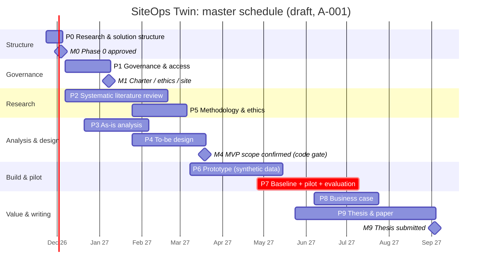

# Master Project Plan: SiteOps Twin

> **Re-plan v0.2 (2026-11-23, D-071): demo first, no fixed calendar.** The user confirmed that there is no academic calendar for now. The **MVP demo** is built first. Then the user feeds a **reference project** to test the model. **POLIMI** is approached with the working demo, and only after that does the work move to **live project data**. The dated Gantt chart below (v0.1) is kept for reference only. The current sequence is:
>
> 1. **D1: MVP demo on synthetic data**. ✅ First iteration built 2026-11-23 (`prototype/`).
> 2. **D2: Reference-project test.** Step-wise intake (`data/templates/REFERENCE_PROJECT_INTAKE.md`), parameter calibration (tolerances, AL-05), and the model–reality gap log.
> 3. **D3: Demo hardening.** User feedback, German-market features (GAEB/Aufmaß export, German UI), and the T8 machine-control import.
> 4. **D4: POLIMI engagement.** Demo, executive brief and research framing → supervisor; then the SLR (open sources, D-072) and the methodology.
> 5. **D5: Live project.** Governance (works agreement, DPIA, D-074), baseline + pilot, evaluation of H1–H5, business case, thesis and paper.

Owner: project-manager. Version 0.1 (Phase 0 draft). Machine-readable copy: [`master_plan.csv`](master_plan.csv).

## 1. Planning basis
- **[A] A-001.** Duration is 40 weeks, from 23 Nov 2026 to the thesis submission around early September 2027. This must be aligned with the POLIMI graduation session calendar (Q-001).
- **[A] A-002.** The student works on the project part-time alongside the Commercial Manager role, at about 15–20 hours per week.
- **[A] A-003.** One spread or work front is available for a 10-week baseline plus pilot window in Q2 2027 (Q-003).
- **[R]** The critical path is **M1 (access and ethics) → M3 → M4 (MVP gate) → M6 → M7 (pilot)**. The pilot window is the hardest constraint, because construction seasonality and spread progress do not wait for the research.

## 2. Phases, milestones and owners

| Phase | Milestone | Lead agent | Depends on | Weeks | Key deliverables |
|---|---|---|---|---|---|
| P0 Research and solution structure | **M0** Phase 0 approved | project-manager | none | 1–2 | This package |
| P1 Governance and access | **M1** Charter, ethics route, pilot site | project-manager | M0 | 3–6 | Charter, stakeholders, RACI, governance and ethics plan, site criteria |
| P2 Systematic literature review | **M2** Synthesis and gap | literature-reviewer | M0 | 3–12 | PRISMA flow, matrix, gap analysis, framework |
| P3 As-is analysis | **M3** As-is validated | process-analyst | M1 | 5–10 | BPMN, DFD, pain points, root causes, KPI baseline |
| P4 To-be design | **M4** MVP scope confirmed (**code gate**) | solution-architect | M3, M2 (partial) | 9–16 | Architecture, data dictionary, ERD, stories, wireframes |
| P5 Methodology and ethics | **M5** Design and consent approved | research-lead | M1, M2 (partial) | 9–14 | DSR design, protocols, metrics, consent |
| P6 Prototype | **M6** MVP demo accepted | full-stack-developer | M4, M5 | 15–24 | Working dashboard on synthetic data |
| P7 Pilot and evaluation | **M7** Pilot analysed | research-lead | M6 | 22–32 | Baseline vs pilot results, UAT/SUS |
| P8 Business case | **M8** Business case | commercial-analyst | M7 (partial) | 28–34 | ROI, NPV, payback, sensitivity, roadmap |
| P9 Thesis and paper | **M9** Submitted | academic-writer | M7, M8 | 26–40 | Thesis, paper |

## 3. Schedule

## 4. Phase-gate rule
A phase closes when the following five conditions hold:
1. All deliverables listed in `master_plan.csv` exist.
2. The quality-reviewer has signed off `qa/phase_N_quality_review.md`.
3. Handover notes are filed.
4. `PROJECT_STATUS.md` is updated.
5. The user approves the phase close-out, which contains the completed deliverables, open questions, decisions required, next actions and the quality checklist.

## 5. Agent sequencing
- **Sequential:** P1 → P3 → P4 → P6 → P7 → P8/P9.
- **Parallel:** P2 runs alongside P1/P3. P5 runs alongside P4. P8 starts once the first pilot results exist.
- See `agents/README.md` for the dependency graph.

## 6. Governance cadence
| Forum | Frequency | Attendees | Purpose |
|---|---|---|---|
| Student / supervisor check-in | Every 2 weeks | Student, POLIMI supervisor | Academic direction |
| Company steering | Monthly | Commercial Manager (sponsor role, Q-010), PM, Site Manager | Access, pilot, decisions |
| Pilot stand-up | Daily, during P7 | Field team, survey, QS | Data completeness |
