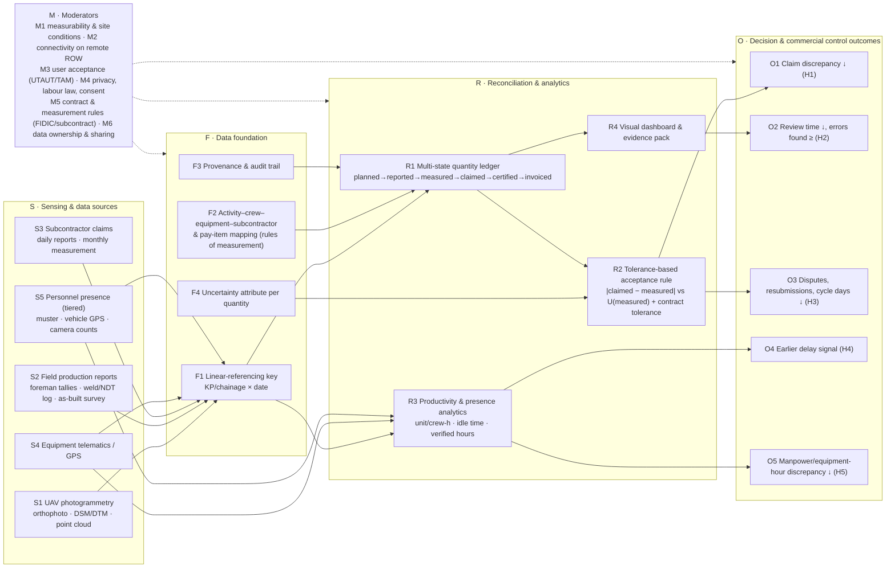

# Conceptual Framework: Measurability-Aware Reconciliation for Linear Construction (Phase 2, provisional)

Owner: literature-reviewer (AI-assisted). Date: 2026-11-23. Derived from `synthesis.md` and `gap_analysis.md`. The framework feeds artefact design (Phase 4) and the evaluation design (P7). Citations are limited to Crossref-verified core records.

## 1. Logic

The framework has four layers and one moderator band.

1. **Sensing and data sources (S).** Independent and self-reported evidence of what happened on the spread.
2. **Data foundation (F).** Integration on a common key: location (KP/chainage) and time, activity, crew, equipment and subcontractor. Every value carries provenance and uncertainty.
3. **Reconciliation and analytics (R).** Comparison of quantity *states*: planned, reported, measured, claimed, certified and invoiced. Acceptance rules apply tolerances derived from measurement uncertainty and the contractual rules of measurement.
4. **Decision and commercial control outcomes (O).** Discrepancy, review effort, certification cycle, disputes, productivity visibility and early delay signals.
5. **Moderators (M).** Technical, organisational, legal and ethical conditions that strengthen or weaken the S→F→R→O chain.

**Where the gaps sit.** The literature is strongest in S (UAV accuracy, tracking technologies) and at the payment-execution end of O (smart contracts). The novel part of the framework is **F and R**: the linear-referenced, uncertainty-carrying data foundation and the tolerance-based reconciliation. These correspond to gaps G1, G3, G4/G4a and G7 in `gap_analysis.md`.

## 2. Diagram

## 3. Constructs, literature and hypotheses

| Construct | Definition (operational) | Literature basis (verified) | Gap addressed | Hypothesis / RQ |
|---|---|---|---|---|
| **S1** UAV photogrammetry | Daily or periodic DSM/DTM, orthophoto and point cloud with stated georeferencing (RTK, PPK, GCP) | Hugenholtz et al. (2015); Varbla et al. (2020); Julge et al. (2019); Kang et al. (2024, 2026); Lee & Lee (2022); Kavaliauskas et al. (2021); Siebert & Teizer (2014) | Pipeline measurability (G2) | RQ1, H1 |
| **S2** Field production reports | The existing records of daily metres and joints | Shahi et al. (2015); Kim et al. (2011); Hlady et al. (2020) | G7 | RQ2, H1 |
| **S3** Subcontractor claims | Claimed quantities per pay item and period | Mohd Safie et al. (2018); Bolton et al. (2022); Malomane & Musonda (2025) | G1, G6 | H1, H3 |
| **S4** Equipment telematics | GPS/telematics time logs and geofenced utilisation | Lee et al. (2018); Pradhananga & Teizer (2013); Navon et al. (2012); Chen et al. (2022) | G9, G10 | H4, H5 |
| **S5** Personnel presence (tiered) | Aggregated, crew-level presence evidence | Gong et al. (2025); Woo et al. (2011); Sherafat et al. (2020) | G5, G9 | H5, RQ5 |
| **F1** Linear-referencing key | KP/chainage × date as the primary join. IFC 4.3 alignment for geometry | Soilán et al. (2020); Garramone & Scaioni (2022); Uggla & Horemuz (2018); Chauhan & Bansal (2026); Morakinyo & Sunmonu (2025) | G4 | RQ2 |
| **F2** Pay-item and measurement-rule mapping | Explicit mapping from measured geometry to contractual pay items and their rules of measurement | Fürstenberg et al. (2024); Won et al. (2019); Chong et al. (2024) | G4a | RQ2, H1 |
| **F3** Provenance and audit trail | Source, time, author and version for every value; immutable change log | Lee et al. (2021); Celik et al. (2023); Lu et al. (2021); Alhasan (2026) | G1 | RQ2, RQ4, H3 |
| **F4** Uncertainty attribute | Expanded uncertainty U per measured quantity, from the survey configuration | Accuracy results in C2 (as above); Zhang et al. (2016); Rebolj et al. (2017) | **G3** | RQ1, H1 |
| **R1** Multi-state quantity ledger | One record per KP-segment × pay item × period × state | Schlenger et al. (2022) (process schema); Sacks et al. (2020) (closed-loop control) | **G1, G4** | RQ2 |
| **R2** Tolerance-based acceptance | Accept, query or reject when \|claimed − measured\| is compared with k·U + contractual tolerance | No verified precedent. Analogues: Julge et al. (2019) (agency requirement); Sadeh et al. (2026) (paired statistical comparison) | **G3** | H1, H3 |
| **R3** Productivity and presence analytics | Unit per crew-hour, idle time, verified hours, delay signal | Kim & Chi (2020); Chen et al. (2020); Mahamedi et al. (2021); Radman et al. (2025); Abdelhamid et al. (2025) | G9, G10 | H4, H5 |
| **R4** Dashboard and evidence pack | Visual review of daily production and the evidence pack for joint measurement | Alizadehsalehi & Yitmen (2021); Rosati et al. (2025); Rahnamayiezekavat et al. (2022) | G8 | RQ3, H2 |
| **O1–O5** Outcomes | As operationalised in `research_framing.md` §3 | Wu & Li (2025); Shehadeh (2025); Radman et al. (2025); Bolton et al. (2022) | G6 | H1–H5 |
| **M1** Measurability and site conditions | Vegetation, moisture, trench exposure time, occlusion | Kang et al. (2026); Hlady et al. (2020); Lee & Lee (2022) | G2, G3 | RQ1 |
| **M2** Connectivity | Intermittent coverage along the ROW | Turner et al. (2021) | G5 | RQ5 |
| **M3** User acceptance | Performance and effort expectancy, social influence, facilitating conditions | Fugate & Alzraiee (2023); Yang et al. (2025); Hewavitharana et al. (2021); Lee et al. (2015); Qin et al. (2020); Seed S17–S18 (Davis, 1989; Venkatesh et al., 2003) | G5 | RQ5 |
| **M4** Privacy, labour law, consent | Legality and proportionality of presence sensing | Wu et al. (2023); Häikiö et al. (2020); Weber-Lewerenz (2021) | G5, G9 | RQ5, H5 |
| **M5** Contract and measurement rules | Subcontract measurement clauses, joint measurement, retention | Alhasan (2026); Malomane & Musonda (2025); Bolton et al. (2022); practice sources PR-02 (FIDIC, to be verified) | G4a | RQ4 |
| **M6** Data ownership and sharing | Who owns, sees and may contest the data | Hwang et al. (2022); Bello et al. (2024) | G1, G5 | RQ5 |

## 4. Propositions linking the framework to H1–H5

| Proposition | Statement | Tested by |
|---|---|---|
| P-H1 | When S1 measurements carry F4 uncertainty and are mapped through F2 to pay items, R2 lowers the absolute claimed-vs-measured discrepancy (O1) compared with document-only reconciliation. | H1 (Wilcoxon, Bland–Altman) |
| P-H2 | R4 shortens the daily review (O2) because the evidence is pre-joined on F1. Error detection does not fall, because R2 flags exceptions. | H2 (time-and-motion, SUS) |
| P-H3 | F3 provenance and R2 acceptance outcomes shared with subcontractors (moderated by M5, M6) reduce disputed line items and certification-cycle days (O3). | H3 (exploratory trend) |
| P-H4 | R3 on S4 data, keyed by F1, surfaces productivity drops at work-front level before conventional reports do (O4). | H4 (lead time) |
| P-H5 | Tiered S5 combined with S4 reduces the discrepancy between claimed and verified manpower and equipment hours (O5). The effect is conditional on M3 and M4. | H5 |

## 5. Status and limitations

- **R2 has no verified precedent.** It is the construct with the weakest literature support and the highest contribution potential, and it should be specified with the field-operations and commercial specialists.
- **The links are argued, not demonstrated.** Moderator effects (M1–M6) are taken from adoption, ethics and site-condition studies. No reviewed study tests them on a pipeline spread.
- **Revision required.** The framework must be revised after Stage-2 full-text screening, snowballing and the P3 interviews.
