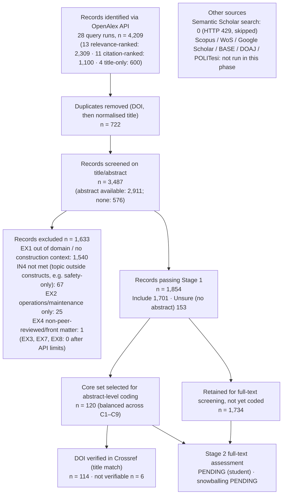

# PRISMA 2020 Flow: Phase 2 Search and Stage-1 Screening (Open Sources)

Owner: literature-reviewer (AI-assisted run). Run date: **2026-11-23**. Protocol: `protocol.md` v0.1 with Amendment A1 (open sources, D-072).
Status: **Identification and Stage-1 (title/abstract) screening complete. Stage 2 (full text), dual screening (κ) and snowballing are pending and must be done by the student.**

All counts below are reproducible from `search_runs/` (`run_openalex.py` → `screen.py` → `verify_crossref.py` → `build_outputs.py` → `gap_stats.py`).

## 1. Flow diagram

**Reconciliation.** 4,209 − 722 = 3,487 screened; 3,487 − 1,633 = 1,854 passing Stage 1; 1,854 = 120 (core) + 1,734 (pool retained); 120 = 114 verified + 6 unverified.

## 2. Counts table

| Step | Source / category | n |
|---|---|---|
| Identification | OpenAlex, 13 relevance-ranked strings (CORE-01, C1–C9, C4-ETH, SUP-PIPE, SUP-PAY), top ≤ 200 each | 2,309 |
| | OpenAlex, same 11 protocol strings ranked by citations (top 100 each; gold-set remedy) | 1,100 |
| | OpenAlex, 4 title-only strings (TTL-C1, C2, C4, C6; top 150 by citations; remedy for missing publisher abstracts) | 600 |
| | **Total identified** | **4,209** |
| | Semantic Scholar search (OA-03) | 0 (HTTP 429) |
| | Semantic Scholar batch, abstract enrichment only (not identification) | 206 records returned; 105 used to fill missing abstracts |
| Deduplication | Duplicates removed (DOI first, then normalised title) | 722 |
| Screening (S1) | Records screened | 3,487 |
| | Excluded EX1 | 1,540 |
| | Excluded IN4 (no substantive cluster construct; mostly safety/ergonomics-only, sustainability-only) | 67 |
| | Excluded EX2 | 25 |
| | Excluded EX4 | 1 |
| | **Total excluded** | **1,633** |
| | Include | 1,701 (incl. 3 manual overrides of rule exclusions: R2072, R0147, R3025) |
| | Unsure (no abstract in open sources; title in scope) | 153 |
| Prioritisation | Core set coded at abstract level (`reference_matrix.csv`) | 120 |
| | Retained for student full-text stage, not coded | 1,734 |
| Verification | Core records with Crossref-verified DOI | 114 |
| | Core records not verifiable (no DOI: 4; DataCite/Zenodo DOI not resolvable here: 2) | 6 |
| Full text (S2) | Reports sought / assessed / excluded | **pending** |
| Included in final review | | **pending** (provisional = 114 verified core records used in synthesis) |

**Core set by primary cluster:** C1 14 · C2 19 · C3 9 · C4 (incl. C4-ETH) 20 · C5 12 · C6 26 · C7 5 · C8 6 · C9 9. Counting all cluster flags (multi-coding): C1 23, C2 35, C3 19, C4 35, C5 24, C6 44, C7 21, C8 30, C9 20.

**Context of the core set:** 16 pipeline / oil-and-gas records; 36 records on linear projects (pipeline, road, highway, rail) in total.

## 3. Search translation and limits

- Strings follow `search_strings.md` §3–§4 and were translated to OpenAlex boolean syntax (`filter=title_and_abstract.search:`). Exact URLs are in `search_log.csv`; raw (trimmed) responses are in `search_runs/<ID>.json`.
- Limits: `from_publication_date:2010-01-01`, `type:article|review|book-chapter|conference-paper`, `language:en`. Raw hit counts were recorded before the limits were applied (`hits_raw`), as §1 of `search_strings.md` requires.
- **Translation deviations (string version v1.1-OA).**
  1. OpenAlex has no truncation operator (`*`). Plural and variant forms were listed explicitly, and OpenAlex stemming covers the rest.
  2. `API*` was replaced by `"application programming interface"` (assumption A-022).
  3. The C8 `W/3` proximity operator is not available, so explicit phrases were used ("measurement uncertainty", "volume uncertainty").
  4. The C3 `W/15` proximity was replaced by AND.
- **Ranking.** Only the top 200 records per string were retrieved, ranked by relevance. This follows the Google Scholar rule in the protocol. Hit totals for C7, C8 and C9 were very large (8,586–41,121), so recall for those clusters depends on the ranking.
- **Gold-set test (§7 of `search_strings.md`).**
  - Version v1.0 (relevance top 200 only, construction narrowed to phrases) retrieved only 1 of the 8 domain seeds (S08–S15).
  - Two remedies were added and logged:
    - (a) the citation-ranked pass;
    - (b) title-only strings. Many Elsevier records have no abstract in OpenAlex, so abstract-based strings cannot match them.
  - Version v1.1 restores plain `construction` in C1, C4, C7 and C8, as in the protocol strings. It retrieves **7 of 8** seeds. The exception is S12 (Golparvar-Fard et al., 2009), which falls outside the 2010 date limit; it is a SEMINAL exemption and is cited from the seed list.
  - The miss rate is 12.5%, which passes the ≤ 20% rule.

## 4. Stage-1 screening rules (transparent, AI-assisted)

Each deduplicated record was screened by `search_runs/screen.py`. The rules below were applied in order to the title and the abstract. The first rule that fires decides the record.

| Order | Rule | Code |
|---|---|---|
| 1 | Front matter, editorial or proceedings index, or a type outside article/review/chapter/conference paper | EX4 |
| 2 | Year before 2010 | EX7 |
| 3 | No construction or infrastructure context phrase. Plain "construction" is **not** enough, because it also matches "construction of a model". The rule needs a construction-specific phrase (e.g. "construction site/project/industry/workers", "road/pipeline/highway construction", contractor, earthwork, BIM, right-of-way). Pipelines are accepted when a construction-phase term is present | EX1 |
| 4 | Out-of-domain term (manufacturing, healthcare, agriculture, forest, mining, heritage, smart city …) and no construction-site phrase | EX1 |
| 5 | Operations/maintenance term (leak, corrosion, ILI, integrity management, FM, SHM, predictive maintenance, pavement distress …) and no construction-phase term | EX2 |
| 6 | No C1–C9 concept in the title or abstract | IN4 |
| 7 | Title is about safety, ergonomics, health, sustainability or cost estimation only, with no core construct (progress, productivity, tracking, quantity, payment, DT, UAV, interoperability, data quality, adoption, privacy …) | IN4 |
| 8 | At least two algorithmic markers, C2, and no construction-measurement application | EX3 |
| 9 | No abstract in OpenAlex or Semantic Scholar | Unsure → full text |
| 10 | Otherwise | Include |

- **Manual overrides** (logged in `screening_log.csv` notes): 3 records were moved from rule exclusion to Include (R2072, R0147, R3025).
- **Screener field.** Every row has the screener value "AI-assisted (to be validated by student)".
- **Known behaviour of the rules.**
  - The rules are deliberately inclusive at Stage 1. A pass rate of 53% is high.
  - Many Stage-1 includes are tangential, mainly safety-oriented computer vision and BIM adoption papers. Stage 2 must remove them.
  - A small number of false exclusions is expected among records whose abstracts lack the construction phrase list.

**Required student actions:**
1. Draw a random 20% sample of the 3,487 records (about 700). Screen it independently and compute Cohen's κ (target ≥ 0.6).
2. Check every EX1 record whose title contains "pipeline", "UAV" or "progress".
3. Run Stage 2 on the 1,854 records that passed Stage 1, starting with the 120 core records.

## 5. Core-set selection (prioritisation, not an eligibility decision)

The full text could not be read here, so a core set of 120 records was selected from the 1,854 records that passed Stage 1. It was selected by judgement, guided by a priority score (`priority` in `screening_log.csv` notes). Selection criteria:
- construction, linear or pipeline context;
- empirical or validated work (field test, case, reference survey);
- relevance to quantity verification, progress measurement, UAV volumetrics/accuracy, tracking technology, DT frameworks, interoperability, data quality and adoption;
- balance across clusters;
- presence of the gold-set seeds.

Five records were added after the gap-test keyword probe (`gap_stats.py`) showed they bear directly on G1, G3, G4 and G6: R0024, R1289, R1341, R1493 and R2276. Five weaker records were dropped to keep the set at 120.

Abstract sources for the core set: OpenAlex 95, Semantic Scholar abstract 10. Nine core records have only a machine-generated Semantic Scholar TLDR (R3119, R3376, R3262, R3263, R0716, R2562, R2670, R1633, R1854). Six have no abstract at all (R0736, R1303, R1715, R0012, R2225, R1272). Their coding is title-level and is flagged in `reference_matrix.csv`.

## 6. Limitations of this phase (to be reported in Chapter 2)

1. **Open sources only.** There was no Scopus/WoS access. The Semantic Scholar search was rate-limited. Google Scholar, BASE, DOAJ and POLITesi were not run.
2. **Missing abstracts.** OpenAlex lacks abstracts for 16.5% of the records screened, mostly Elsevier titles. This biases keyword screening against *Automation in Construction* and *Advanced Engineering Informatics*.
3. **Truncated retrieval.** Retrieval is capped at the top 200 by relevance and the top 100 by citations. Broad clusters (C7–C9) are therefore sampled, not exhausted.
4. **Screening and coding are AI-assisted and abstract-level.** They are not validated. Quality bands are provisional.
5. **Pending steps.** Full text, the κ check and snowballing are pending, so the "included" set is provisional.
