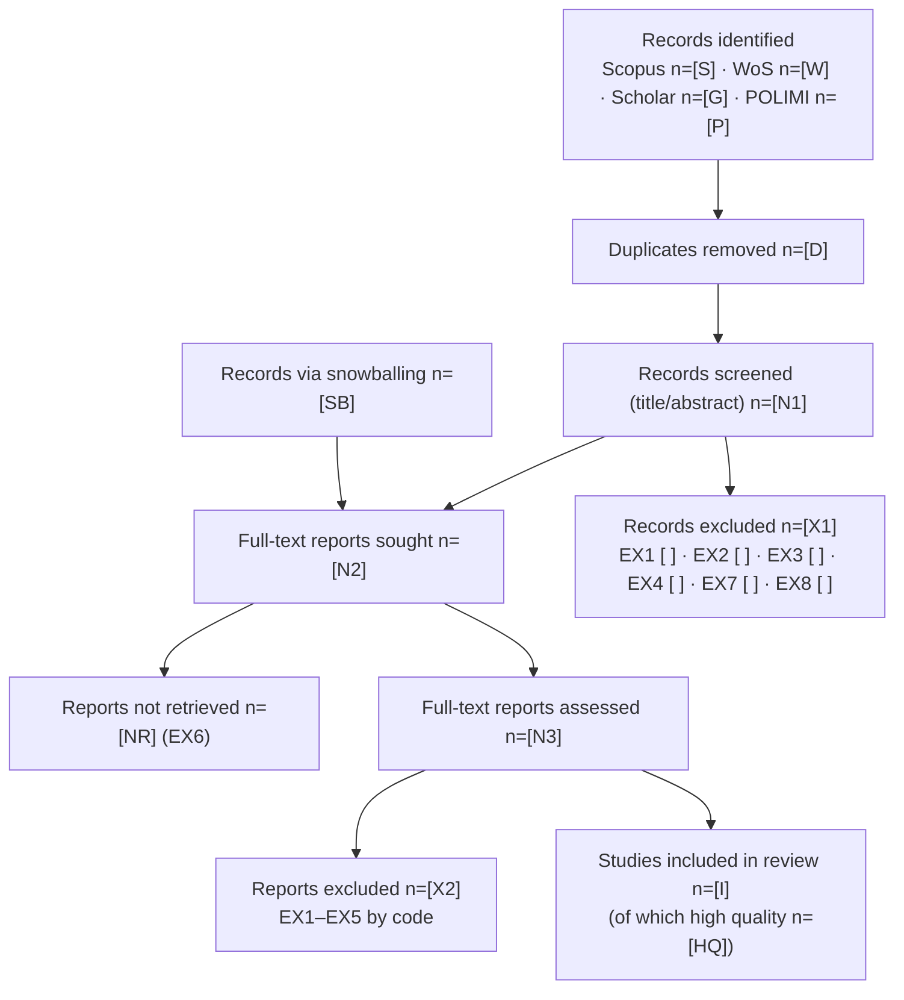

# Systematic Literature Review Protocol (PRISMA 2020-style)

Owner: literature-reviewer. Version 0.1 (Phase 0). Status: draft for research-lead and supervisor review.
Reporting guideline: PRISMA 2020 (Page et al., 2021). Procedures informed by Kitchenham and Charters (2007). See `seed_references.md`; all seed entries are marked VERIFY.

## 1. Purpose and objectives
**[F]** The review supports the main RQ and RQ1–RQ5 in `05_methodology/research_framing.md`.

| Objective | Review question | Serves RQ |
|---|---|---|
| O1 | What is the state of the art in construction and oil-and-gas digital twins, specifically for operations and commercial control as opposed to design or asset operation? | Main RQ, RQ2 |
| O2 | Which quantities can UAV photogrammetry measure, with what reported accuracy and uncertainty, and under which flight and georeferencing conditions? | RQ1 |
| O3 | How are BIM, GIS and linear referencing integrated for linear infrastructure (pipelines, roads, rail)? | RQ2 |
| O4 | Which personnel and equipment tracking technologies have been validated on construction sites, with what accuracy, cost and ethical constraints? | RQ5, H4 |
| O5 | How are productivity, progress and earned value measured automatically, and with what effect on decisions? | RQ3, H2, H4 |
| O6 | What evidence exists on automated quantity takeoff, progress-payment verification and subcontractor certification, and on their effect on disputes? | RQ4, H1, H3 |
| O7 | Which interoperability standards apply (IFC 4.3, LandXML, ISO 19650, OGC, PODS, OPC UA, ISO 15143-3, open APIs)? | RQ2 |
| O8 | How are data quality, uncertainty, validation and auditability handled in construction data platforms? | RQ1, RQ2 |
| O9 | Which factors explain adoption or resistance for construction technologies (TAM, UTAUT, change management)? | RQ5 |

## 2. Topic clusters
| Code | Cluster | Core concepts |
|---|---|---|
| C1 | Digital twins in construction and oil & gas | digital twin, cyber-physical system, construction digital twin, DTC, oil and gas, pipeline |
| C2 | UAV photogrammetry and surveying | UAV/UAS/drone, structure-from-motion, orthophoto, DEM/DSM/DTM, point cloud, earthwork volume, GCP, RTK/PPK |
| C3 | BIM/GIS for linear infrastructure | BIM–GIS integration, linear referencing, chainage/stationing, alignment, IFC Alignment, corridor |
| C4 | Personnel/equipment tracking | IoT, RFID, BLE, UWB, GNSS/GPS, telematics, computer vision, wearables, activity recognition |
| C5 | Productivity monitoring and EVM | labour/equipment productivity, activity analysis, earned value, schedule performance |
| C6 | Progress measurement, quantity and payment | automated progress monitoring, quantity takeoff, progress payment, subcontractor payment, invoice verification, claims |
| C7 | Interoperability and standards | IFC 4.3, LandXML, ISO 19650, OGC, CityGML, PODS, OPC UA, ISO 15143-3, API |
| C8 | Data quality, uncertainty, auditability | data quality, measurement uncertainty, validation, provenance, audit trail, blockchain (as audit mechanism) |
| C9 | Change management and adoption | technology adoption, TAM, UTAUT, diffusion of innovation, resistance to change, digital transformation |

## 3. Eligibility (PICOC)
| Element | Definition |
|---|---|
| **P**opulation | Construction projects. Priority goes to linear infrastructure and oil-and-gas pipelines. Buildings and civil works are included where the method transfers. |
| **I**ntervention | Digital twins, UAV photogrammetry, tracking technology, integrated data platforms or automated reconciliation used for progress, quantity, productivity or commercial control |
| **C**omparison | Manual or conventional survey, reporting and certification (where reported) |
| **O**utcomes | Accuracy and uncertainty, time, cost, disputes and claims, productivity, decision quality, adoption and usability |
| **C**ontext | Field sites, including remote ones and those with limited connectivity. Contractor or owner perspective. |

## 4. Inclusion and exclusion criteria
**Inclusion:**
| Code | Criterion |
|---|---|
| IN1 | Peer-reviewed journal article, peer-reviewed conference paper (e.g. ISARC, CIB W78, EC3, ASCE i3CE) or doctoral thesis |
| IN2 | Published 2010–2026. Seminal works (frameworks, methods, standards) are exempt from the date limit and flagged `SEMINAL` |
| IN3 | English full text. Italian full text for POLIMI sources |
| IN4 | Addresses at least one cluster C1–C9 **and** a construction, infrastructure or energy context (C9 may draw on general IS adoption theory) |
| IN5 | Reports a method, an artefact, empirical evidence or a structured review |

**Exclusion:**
| Code | Criterion |
|---|---|
| EX1 | Out of domain: manufacturing, healthcare or smart-city operations with no construction transfer |
| EX2 | Operations and maintenance phase only (asset integrity, in-line inspection, leak detection), with no construction-phase relevance |
| EX3 | Purely algorithmic computer-vision or photogrammetry improvement with no construction measurement application |
| EX4 | Editorials, abstracts only, posters, non-peer-reviewed vendor white papers. Grey literature is handled under §5 |
| EX5 | Duplicate, or a superseded version of the same study (keep the most complete) |
| EX6 | Full text not obtainable through POLIMI library services or interlibrary loan |
| EX7 | Outside the date range and not seminal |
| EX8 | Language other than English or Italian |

## 5. Grey literature and standards policy
- Standards are **not screened**. They are cited directly as normative sources and logged in `seed_references.md` with their edition. Examples: ISO 19650, ISO 16739-1, ISO 15143-3, IEC 62541, OGC, PODS, ANSI/EIA-748, PRISMA.
- Industry reports are included only in a separate *grey-literature annex*. Examples: FIDIC measurement provisions, AACE recommended practices, IOGP guidance, professional-body reports. They are never used as evidence for H1–H4 effect sizes.
- **[R]** Vendor material on `[DRONE_SW]` capability may inform the architecture. It is not cited as evidence of accuracy.

## 6. Information sources
- Scopus and Web of Science Core Collection are the primary sources.
- Google Scholar is used as a supplementary source, limited to the first 200 results by relevance per string.
- POLIMI institutional sources: POLITesi (theses), RE.PUBLIC@POLIMI (institutional research repository), and the POLIMI library discovery service.
- Backward and forward snowballing on the included core papers, one iteration (Wohlin-style).
- Exact strings are in `search_strings.md`.

## 7. Record management and deduplication
1. Export RIS/BibTeX with abstracts from every source into Zotero (or an equivalent).
2. Deduplicate automatically on DOI, then on normalised title + year + first author. Resolve the remaining cases manually.
3. Every record gets a stable `record_id` (`R0001`…) before screening. It is logged in `screening_log_template.csv` (copied to `screening_log.csv` in Phase 2).

## 8. Screening procedure
| Stage | Basis | Decision | Rules |
|---|---|---|---|
| S1 | Title + abstract + keywords | Include / Exclude / Unsure | Unsure goes to S2. Record the exclusion code |
| S2 | Full text | Include / Exclude | Record the exclusion code. Apply quality appraisal (§9) |

- **Dual screening.** A second screener (supervisor, co-supervisor or a peer student, Q-020) independently screens a random **20% sample** at S1 and S2.
- Agreement is measured with **Cohen's κ**. The target is **κ ≥ 0.6**. If κ falls below 0.6, criteria are clarified, then the sample is re-screened.
- Disagreements are resolved by discussion. The research-lead decides if they remain unresolved.
- **[A] A-020.** A second screener is available for about 6–8 hours.

## 9. Quality appraisal
Adapted from MMAT/CASP-style criteria. Each item scores 0 (no), 0.5 (partly) or 1 (yes). The maximum is 8.

| Q | Criterion |
|---|---|
| QA1 | Research aim/question clearly stated |
| QA2 | Method appropriate to the aim |
| QA3 | Context described (project type, scale, site conditions) |
| QA4 | Data collection and sample described |
| QA5 | Validation against a reference (e.g. total station, manual measurement) or a control condition |
| QA6 | Accuracy, uncertainty or effect size reported quantitatively |
| QA7 | Limitations and threats to validity discussed |
| QA8 | Findings transferable to linear or pipeline construction |

Bands: high (6 or more), medium (4–5.5), low (under 4). **[R]** Low-quality studies are kept for mapping, but are excluded from claims about evidence strength.

## 10. Data extraction
Use `reference_matrix_template.csv`. Fields:
- bibliographic data, DOI and verification flag
- cluster flags C1–C9
- research method, sector and context, project type
- data sources, technology
- quantity or metric type
- validation approach and reported accuracy or uncertainty
- key findings, limitations
- relevance to H1–H4 and to RQ1–RQ5

A pilot extraction is run on 5 papers to calibrate the fields.

## 11. Synthesis
1. **Descriptive and bibliometric mapping:** publications per year, venue, country and cluster. Optionally, keyword co-occurrence in VOSviewer.
2. **Concept matrix** (Webster & Watson style): cluster × outcome × context, to show coverage density and empty cells.
3. **Thematic synthesis:** codes, then themes, per objective O1–O9.
4. **Evidence tables** for quantitative outcomes: UAV accuracy, tracking accuracy, time and dispute effects. No meta-analysis is planned because of expected heterogeneity. **[A] A-021.**
5. **Gap analysis:** test the candidate gaps in `gap_hypotheses.md`. Each gap is tagged *confirmed*, *partially confirmed* or *rejected*, then mapped to an RQ.
6. **Conceptual framework diagram**, which feeds the artefact design in Phase 4.

## 12. PRISMA 2020 flow diagram (template)

Each count must reconcile at every step. For example: N1 = S + W + G + P − D; N2 = N1 − X1 + SB.

## 13. Reporting and outputs (Phase 2)
| Output | File |
|---|---|
| Search log | `search_log.csv` |
| Screening log and κ | `screening_log.csv` |
| PRISMA flow with counts | `prisma_flow.md` |
| Reference matrix | `reference_matrix.csv` |
| Bibliography | `references.bib` |
| Synthesis | `synthesis.md` |
| Gap analysis | `gap_analysis.md` |
| Framework | `conceptual_framework.md` |

The thesis Chapter 2 follows the PRISMA 2020 checklist items that apply to an SLR in engineering management.

## 14. Timeline (within P2, weeks 3–12)
| Weeks | Activity |
|---|---|
| 3 | Protocol approved; strings piloted and refined; registration (optional, e.g. OSF, Q-021) |
| 4 | Searches run and exported; deduplication |
| 5–6 | S1 screening plus κ sample |
| 7–9 | Full-text retrieval, S2 screening, quality appraisal, extraction |
| 10 | Snowballing |
| 11–12 | Synthesis, gap analysis, framework, draft Chapter 2 |

## 15. Roles
| Role | Responsibility |
|---|---|
| literature-reviewer (student) | Searches, screening, extraction, synthesis |
| Second screener (Q-020) | 20% dual screening |
| research-lead | Arbitration, alignment with the RQs |
| POLIMI supervisor | Protocol approval |
| quality-reviewer | Reconciliation of counts, DOI verification audit |

## 16. Protocol amendments
Any change after the searches start is dated and justified in this section, and logged in `DECISIONS_LOG.md`.
