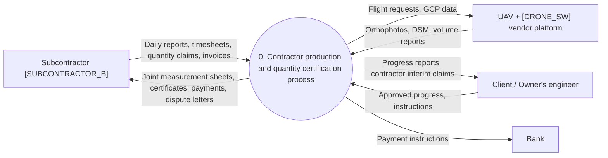
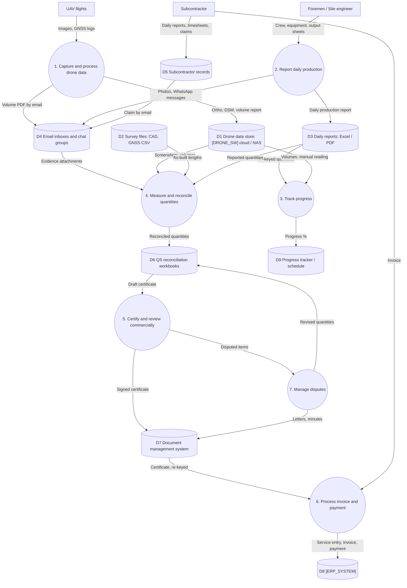

# As-Is Data-Flow Diagram (DFD)

Owner: process-analyst. Version 0.1 (Phase 0). **[A] HYPOTHETICAL**: to be validated in P3.
Process numbers align with the step IDs in [as_is_process_map.md](as_is_process_map.md).

## Level 0: Context diagram

## Level 1

## Integration breaks identified [A]

| Break ID | Break | Where | Effect | Requirement it drives |
|---|---|---|---|---|
| DB-01 | **No common location key.** Drone data is indexed by flight area and coordinates. DPRs use KP ranges or landmarks. Subcontractor claims use BoQ items, sometimes with "corners" or sections | D1, D3, D5 | Quantities cannot be joined automatically by location | Linear referencing on KP; section register (D-004) |
| DB-02 | **No common time base.** Flight capture time, shift date and claim period do not align. Work at night or after the flight is attributed to the wrong day | P1, P2, P4 | Daily measured vs reported comparisons are biased | UTC event timestamps; flight-to-shift attribution rule |
| DB-03 | **Manual re-keying** of the same quantity 3–4 times: foreman sheet → DPR → tracker → QS workbook → ERP | D3, D9, D6, D8 | Transcription errors, latency, version drift | Capture once at source; system-of-record per quantity state |
| DB-04 | **Version uncertainty.** Multiple Excel and PDF copies travel by email. There is no single approved version of a daily quantity | D3, D4, D6 | Disputes about which number is "right" | Immutable versioned records; approval status |
| DB-05 | **Evidence not linked to quantities.** Photos, orthophotos and survey points are not attached to the specific quantity record, KP range and date | D1, D4, D6 | Evidence searches during disputes take days | Evidence references on every quantity record |
| DB-06 | **No crew/equipment link to output.** Timesheets and equipment logs are not linked to the activity and section produced | D3, D5 | No productivity per crew or section; late delay detection (H4) | Crew/equipment-to-activity assignment per shift |
| DB-07 | **Commercial states not modelled.** Planned, reported, measured, claimed, certified and invoiced quantities live in different files | D9, D3, D1, D5, D6, D8 | Overpayment and duplicate claims are hard to detect | Five-state quantity model (D-008) |
| DB-08 | **Undocumented tolerance.** Accepted differences between survey and claim are applied case by case | P4, P5 | Inconsistent certification | Tolerance rules per BoQ item |
