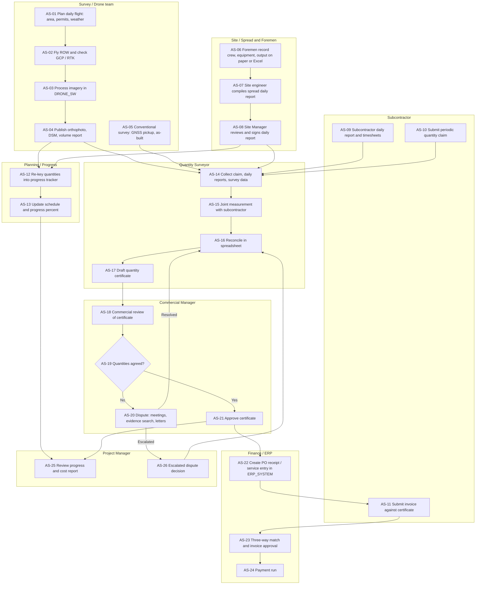

# As-Is Process Map: From Drone Flight to Subcontractor Invoice

Owner: process-analyst. Reviewer: field-operations-specialist. Version 0.1 (Phase 0).

> **[A] HYPOTHETICAL AS-IS.** This map is built from the user brief and from typical pipeline-contractor practice. It must be validated through practitioner interviews and walkthroughs in Phase 3 (T-301, T-302) before it is used as a research baseline. Placeholders: `[SPREAD_ID]`, `[SUBCONTRACTOR_B]`, `[DRONE_SW]`, `[ERP_SYSTEM]`.

## 1. Swimlane flowchart

## 2. Step table

The typical durations are **[A]** and will be replaced by measured values during the baseline period.

| ID | Lane | Step | Input | Output | System / medium | Frequency | Typical duration [A] | Issue link |
|---|---|---|---|---|---|---|---|---|
| AS-01 | Survey/Drone | Plan the daily flight | Work-front locations, weather, airspace permits | Flight plan | Flight-planning app | Daily | 15–30 min | PP-03 |
| AS-02 | Survey/Drone | Fly the ROW and check GCP/RTK | Flight plan | Raw images, GNSS logs | UAV, base station | Daily | 1–3 h per spread | PP-03, PP-04 |
| AS-03 | Survey/Drone | Process the imagery | Images, GCPs | Point cloud, DSM, orthophoto | `[DRONE_SW]` | Daily | 3–8 h (often overnight) | PP-04 |
| AS-04 | Survey/Drone | Publish outputs | Processed models | Orthophoto, DSM, volume report (PDF/CSV) | `[DRONE_SW]` portal, email | Daily or on request | 30 min | PP-01, PP-05 |
| AS-05 | Survey/Drone | Conventional survey and as-built | Survey requests | As-built points, trench profiles | GNSS rover, CAD | As needed | 2–6 h | PP-01 |
| AS-06 | Site/Foremen | Record crew, equipment and output | Field observation | Foreman sheet | Paper, WhatsApp photo, Excel | Daily, per crew | 15–30 min at shift end | PP-02, PP-06, PP-12 |
| AS-07 | Site/Foremen | Compile the spread daily report | Foreman sheets | Daily production report (DPR) | Excel, email | Daily | 1–2 h | PP-02, PP-07 |
| AS-08 | Site/Foremen | Review and sign the DPR | DPR draft | Signed DPR (PDF) | Excel, PDF, email | Daily | 15–30 min | PP-07 |
| AS-09 | Subcontractor | Daily report and timesheets | Subcontractor crew records | Subcontractor daily report, timesheets | Paper, Excel | Daily | 30–60 min | PP-08, PP-09 |
| AS-10 | Subcontractor | Submit the quantity claim | Their own records | Interim claim per BoQ item | Excel, PDF letter | Weekly or monthly | 1–2 days to prepare | PP-08, PP-10 |
| AS-11 | Subcontractor | Submit the invoice | Approved certificate | Invoice | PDF, ERP supplier portal | Monthly | 1 day | PP-14 |
| AS-12 | Planning/Progress | Re-key quantities into the tracker | DPR, drone volumes | Progress tracker | Excel or planning tool | Daily or weekly | 1–2 h | PP-07, PP-11 |
| AS-13 | Planning/Progress | Update schedule and progress % | Tracker | Progress % per activity | Scheduling software | Weekly | 2–4 h | PP-11 |
| AS-14 | QS | Collect the evidence pack | Claim, DPRs, subcontractor reports, survey data | Evidence folder | Email, shared drive | Per claim | 0.5–2 days | PP-05, PP-13 |
| AS-15 | QS | Joint measurement | Evidence, site visit | Joint measurement sheet (signed) | Paper, Excel | Per claim | 0.5–2 days | PP-01, PP-10 |
| AS-16 | QS | Reconcile in a spreadsheet | All sources | Reconciled quantities | Excel | Per claim | 1–3 days | PP-01, PP-02, PP-10, PP-13 |
| AS-17 | QS | Draft the certificate | Reconciled quantities, rates | Draft quantity certificate | Excel, Word | Per claim | 0.5 day | PP-15 |
| AS-18 | Commercial Manager | Commercial review | Draft certificate | Review comments | Excel, email | Per claim | 0.5–1 day | PP-13, PP-15 |
| AS-19 | Commercial Manager | Agreement decision | Review | Agreed or disputed | n/a | Per claim | n/a | PP-10 |
| AS-20 | Commercial Manager | Manage the dispute | Disputed items | Meetings, letters, revised quantities | Email, letters, meetings | Per dispute | Days to weeks | PP-10, PP-13 |
| AS-21 | Commercial Manager | Approve the certificate | Agreed quantities | Approved certificate | PDF signature | Per claim | 1–3 days (signature chain) | PP-14 |
| AS-22 | Finance/ERP | Service entry / goods receipt | Certificate | Service entry sheet | `[ERP_SYSTEM]` | Per certificate | 0.5 day | PP-07, PP-14 |
| AS-23 | Finance/ERP | Three-way match and approval | PO, service entry, invoice | Approved invoice | `[ERP_SYSTEM]` | Per invoice | 2–10 days | PP-14 |
| AS-24 | Finance/ERP | Payment run | Approved invoice | Payment | `[ERP_SYSTEM]`, bank | Per payment terms | Per payment terms | PP-14 |
| AS-25 | Project Manager | Review progress and cost | Tracker, certificates | Monthly report | Excel, PPT | Weekly or monthly | 0.5 day | PP-11 |
| AS-26 | Project Manager | Escalated dispute decision | Dispute file | Instruction or decision | Meeting minutes | Per escalation | Days | PP-10 |

## 3. Narrative

**Two information chains run in parallel and do not meet until certification.**

- **The "technical truth" chain (AS-01 to AS-05).** The drone and survey team produce high-quality daily imagery and volumes. These are organised by flight and date, not by BoQ item, chainage section or subcontractor. They reach the QS mainly as PDFs or email attachments.
- **The "reported truth" chain (AS-06 to AS-10).** Foremen, the site engineer and the subcontractor record production on paper or in Excel. These records use their own location references (KP ranges, landmarks, "corners") and their own activity names.

The QS reconciles both chains by hand (AS-14 to AS-16), often weeks after the work happened. By then, activities that disappear underground have been covered. These include trench bottom, padding, lowering-in and backfill layers. Evidence can then only be reconstructed from photos and memory, which makes disputes (AS-20) costly.

Personnel and equipment data stays on foreman sheets and timesheets. Productivity per crew and per section is therefore not visible in time to act on a slowdown.

## 4. BPMN 2.0 export note (for P3)
- Phase 3 will redraw this map in BPMN 2.0 using bpmn.io or Camunda Modeler. It will be stored as `as_is_process.bpmn` with a PNG export.
- The redraw will add a pool per organisation (Contractor, Subcontractor) and lanes per role.
- It will use message flows for inter-company exchanges (claims, certificates, invoices) and data objects or data stores for each artefact.
- It will mark timer events for the daily, weekly and monthly cycles.
- Step IDs AS-01 to AS-26 are kept as element IDs so the BPMN stays traceable to the pain-point register and the KPI baseline.
- Variants between spreads, such as weekly vs monthly claims, are handled in the redraw rather than here.
