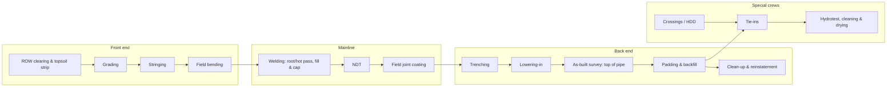

# Industry-Practice Alignment of the As-Is Model

Owner: field-operations-specialist, with the process-analyst. Version 0.1. Basis: the practice-grounding rules in `02_literature_review/industry_practice_sources.md` (IPLOCA first).

Purpose: test the hypothetical as-is map (AS-01 to AS-26) against how onshore pipeline spreads actually run. Where the draft model is unrealistic or missing a practical step, this file says so. Items tagged **[A]** need validation through the Road to Success guidance (T-206) and the P3 interviews.

## 1. Practical spread structure the model must reflect

**[A] A-016.**
- Crews advance at different daily rates. Typical sequencing gaps between front end and back end are several kilometres, set by the spread plan.
- Trenching can come before or after welding, depending on terrain and method.
- The model must not assume a single, fixed order. AL-08 must use a configurable precedence table per spread.

## 2. Alignment check against the draft as-is

| # | Practical reality [A], to be validated against IP-01 and interviews | Draft model status | Action |
|---|---|---|---|
| 1 | Daily progress is reported per crew in **metres or joints** on foreman tally sheets. Welds come from the **weld log** (joint number, welder ID, KP) and NDT reports | Covered in AS-06 and AS-07; weld log not explicit | Add the weld log and NDT record as a data store in the P3 BPMN. This is already reflected in D-052 and A-064 |
| 2 | The **as-built survey crew** records top-of-pipe and joint positions before backfill. This is a contractual deliverable | Not explicit | Add an as-built survey step between lowering-in and backfill. Use it as an independent witness (rule 3) |
| 3 | **Pipe tally / material tracking** (pipe joints received, strung, welded, scrapped) controls stringing and welding counts | Missing | Add as a source for STR and WLD reconciliation (roadmap: material reconciliation) |
| 4 | **Joint measurement** with the subcontractor (often weekly) agrees quantities before the monthly certificate | AS joint-measurement step present | Keep it. The MVP produces a joint-measurement evidence pack (S6/S7) |
| 5 | Delays are recorded in daily reports with **cause codes**: weather, landowner access, permits, material, breakdown, standby | Partly (delays/weather in E2) | Adopt a standard delay-code list in E2. It supports H4 and later standby claims |
| 6 | **Landowner/land-entry constraints** create gaps in the ROW. Crews "skip" sections and come back later | Not modelled | Sections can carry a status of *access-restricted*. The productivity alert (AL-05) excludes restricted days |
| 7 | **Equipment** on spreads is a mix of owned, hired and subcontractor plant. Telematics coverage is partial | A-008 | E8 must accept mixed coverage: telematics where available, check-in otherwise |
| 8 | Crews work **rotations** and sometimes long shifts, with multilingual workforces | Not modelled | Mobile UI is icon-led and multilingual (Q-060). The production-day cutoff is configurable (Q-041) |
| 9 | Drone flights are limited by **wind, dust, rain, airspace permits** and battery logistics | Partly (A-004) | Missing-flight days are normal. The reconciliation must fall back to field and as-built evidence and mark items UNVERIFIABLE, not DISCREPANCY |
| 10 | **Reinstatement** is often accepted by the landowner or client per parcel, not per metre | Not modelled | Allow the parcel or area as the unit for RST. Q-011 "corner" may mean the land parcel |

## 3. Implications carried into the design [R]
- Data model: add **weld log**, **as-built survey points**, **pipe tally**, **delay codes**, **section access status** and **precedence table**. These are logged as backlog items for Phase 4. Weld log, as-built survey and delay codes are MVP candidates; the rest go on the roadmap.
- Synthetic data: seed access-restricted sections and drone no-fly days, so that alerts are tested against realistic noise (R-53).
- Pilot: the field-operations-specialist confirms the spread plan and crew sequence before the baseline starts.
