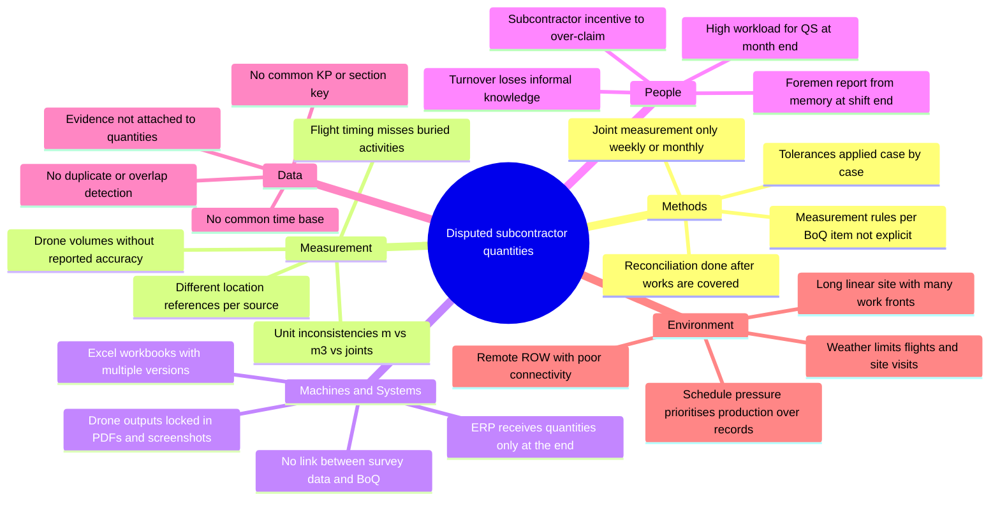

# Root-Cause Preview: Disputed Subcontractor Quantities

Owner: process-analyst. Version 0.1 (Phase 0).

> **[A] PRELIMINARY.** The causes below are hypotheses derived from the hypothetical as-is map and from typical pipeline practice. Phase 3 will test them through interviews, dispute-log analysis and a sample of past certificates (T-303).

**Effect (problem statement):** Subcontractor quantity claims are frequently disputed, which delays certification and payment.

## 1. Ishikawa (6M adapted)

## 2. 5-Whys example [A]

| # | Why? | Answer [A] |
|---|---|---|
| Problem | | The subcontractor claims 1,250 m of backfilled trench in section `[SPREAD_ID]-S07`. The QS accepts 1,130 m, and the 120 m difference is disputed. |
| 1 | Why is there a difference? | The QS cannot confirm that 120 m was backfilled within the claim period. |
| 2 | Why can it not be confirmed? | The drone volume report for those dates covers a different KP range, and the DPRs give "near crossing X" rather than KP values. |
| 3 | Why are the location references inconsistent? | Each source uses its own location convention. There is no agreed section register or KP key. |
| 4 | Why is there no shared register? | Quantities are reconciled only at claim time, by spreadsheet. Nobody owns an integrated, location-referenced daily record. |
| 5 | Why is there no integrated daily record? | The current tools (`[DRONE_SW]`, Excel, `[ERP_SYSTEM]`) each serve one function, and the process was never designed around a shared data model. |
| **Root cause [A]** | | **There is no shared, location- and time-referenced quantity record agreed daily between the parties.** This drives requirements on the KP linear-referencing key (D-004), the five-state quantity model (D-008) and daily agreed quantities. |

## 3. Next steps (P3)
- Validate each cause against at least 3 dispute cases.
- Rank the causes using the frequency and value of the disputes they caused (Pareto).
