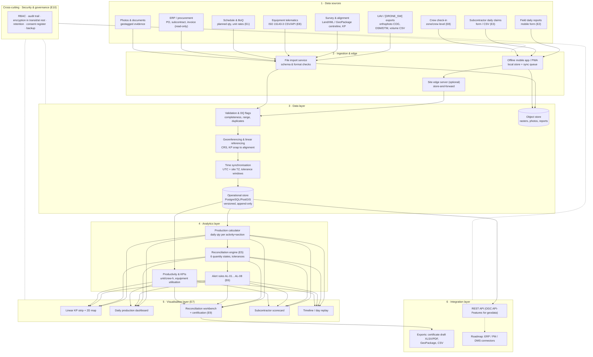
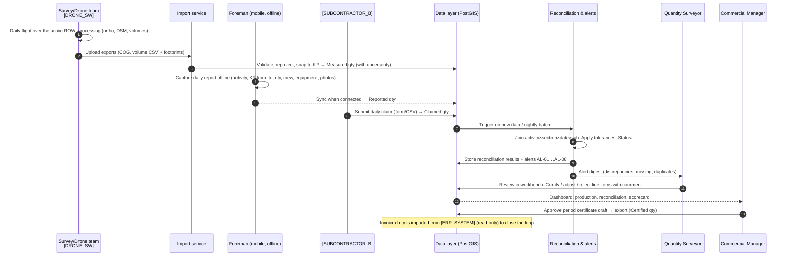

# Conceptual Architecture: SiteOps Twin

Owner: solution-architect. Version 0.1 (Phase 0 concept). Status: for review.

Reviewers: data-engineer, gis-engineer, field-operations-specialist.

Tags: **[F]** fact · **[A]** assumption · **[R]** recommendation.

## 1. Design principles
1. **[R] Complement, don't replace.**
   - The system ingests `[DRONE_SW]` exports (orthophoto, DSM/DTM, volume reports). It does not re-process imagery (D-007).
2. **[R] One location key.**
   - Every record carries a chainage/KP range on the alignment (D-004).
   - The join key for all data is activity × section × date × subcontractor.
3. **[R] Quantity states, not quantity copies.**
   - A quantity moves through six states: Planned → Reported → Measured → Claimed → Certified → Invoiced (D-008).
   - Each state is stored as a separate, immutable record that carries its provenance.
4. **[R] Offline-first at the edge.**
   - **[A] A-009.** Connectivity is intermittent along the ROW.
   - Capture must work with no connection and sync later.
5. **[R] Explainable controls before machine learning.**
   - Alerts are rule-based with stated tolerances.
   - Machine learning is on the roadmap only.
6. **[R] Privacy by design.**
   - Presence is recorded at crew and zone level only. No individual tracking (D-006).
7. **[R] Open standards and file interfaces first.**
   - The MVP uses file-based imports (CSV, GeoTIFF, GeoPackage, LandXML).
   - APIs are on the roadmap (R-08).

> **Update (2026-11-23).** The field-sensing layer has been extended beyond the drone: muster check-in, vehicle GPS, plant trackers, camera counts and optional badges, with a work-front registry and a privacy filter. See [`field_sensing_layer.md`](field_sensing_layer.md) (E11, D-069). Sources S5 and S6 below are generalised by that document.

## 2. Layered architecture

## 3. Components

| Layer | Component | Responsibility | MVP? |
|---|---|---|---|
| Ingestion | Offline mobile app (PWA, or ODK-compatible form) | Captures field reports, claims, crew check-in and photos. Stores them locally and queues them for sync. Supports a conflict-resolution UI | Yes |
| Ingestion | File import service | Imports the alignment (LandXML/GeoPackage), BoQ/schedule (CSV), drone volume/length CSV with footprint polygons (GeoPackage/GeoJSON), orthophoto (COG) and telematics CSV. Rejects invalid files and reports the reason | Yes |
| Ingestion | Site edge server | Store-and-forward when the site office has a better link than the ROW. Serves map tiles locally | Optional (deployment option B/C) |
| Data | Validation and DQ flags | Checks required fields, unit and range, KP within the spread, date within the window, duplicate submissions and overlapping KP ranges | Yes |
| Data | Linear referencing | Snaps geometry to the alignment and computes KP from–to. Assigns records to sections `[SPREAD_ID]-S##` | Yes |
| Data | Time sync | Stores every timestamp in UTC together with the site time zone. Assigns records to a "production day" by a configurable cutoff (Q-041) | Yes |
| Data | Operational store | PostgreSQL/PostGIS (SQLite/SpatiaLite for the demo). Append-only quantity records with `version`, `source`, `provenance` and `superseded_by` fields | Yes |
| Data | Object store | Rasters, photos and PDFs with hashes (SHA-256) for evidence integrity | Yes (local folder in the MVP) |
| Analytics | Production calculator | Aggregates reported and measured quantities per activity × section × day | Yes |
| Analytics | Reconciliation engine | Compares the quantity states. Applies per-activity tolerance (absolute and %). Assigns status MATCHED, WITHIN_TOLERANCE, DISCREPANCY or UNVERIFIABLE | Yes |
| Analytics | Alert rules | AL-01…AL-08, each with an explanation payload (rule, inputs, threshold) | Yes |
| Analytics | Productivity and KPIs | Units per crew-hour, equipment utilisation and idle %, rolling medians | Yes (basic) |
| Visualisation | Dashboard | KP strip, map, production, reconciliation workbench, scorecard, timeline | Yes |
| Integration | API and exports | Internal REST API. Certificate draft export. GeoPackage/CSV export | Yes (exports). API internal only |
| Security | RBAC and audit trail | Roles: Field, Subcontractor, Survey, QS, Commercial, PM, Admin, Auditor (read-only). Every state change is logged (who, when, before → after) | Yes (basic) |

## 4. Traceability: target-state objectives → components → epics

| # | Target-state objective (user brief) | Components | Epics |
|---|---|---|---|
| 1 | Live or near-live map/model of the site | Orthophoto import (COG), KP strip, map; 3D viewer is on the roadmap | E1, E4, E7 |
| 2 | Visualisation of personnel, crews, equipment, work fronts and activities | Crew check-in, telematics import, map layers | E2, E7, E8 |
| 3 | Minute- or event-level activity tracking where feasible | Event-timestamped reports, telematics events, timeline view. **[A] A-040** says MVP granularity is event level, not minute level | E2, E8, E7 |
| 4 | Automated or semi-automated daily production records | Production calculator from structured reports | E2, E5 |
| 5 | Accurate measurement of work completed per section | Drone import with uncertainty, linear referencing | E1, E4 |
| 6 | Subcontractor quantity tracking by activity, front, date, crew and equipment | Claim capture, data model join keys | E3, E5 |
| 7 | Planned vs measured vs claimed vs approved/invoiced comparison | Reconciliation engine, workbench | E5, E7, E9 |
| 8 | Alerts for deviations, missing data, duplicates, slowdowns and invoicing risk | Alert rules AL-01…AL-08 | E6 |
| 9 | Data foundation for EVM, productivity analysis and disputes | Versioned store, audit trail, exports. EVM is on the roadmap | E10 (+ roadmap) |

## 5. Standards and interoperability

| Standard | Use in SiteOps Twin | MVP use |
|---|---|---|
| ISO 19650-1/-2 (information management using BIM) | Information containers, status codes (WIP/Shared/Published/Archived) and a common data environment (CDE) approach for evidence and certificates | Naming and status conventions |
| IFC 4.3 (ISO 16739-1:2024): IfcAlignment, linear placement | Future exchange of alignment and linear-referenced elements with BIM tools | No (roadmap) |
| LandXML 1.2 | Importing the alignment centreline and stationing | Yes (import) |
| OGC WMS/WMTS, WFS, OGC API–Features/Tiles | Serving orthophoto tiles and vector features to clients and GIS | OGC API–Features style endpoints (lite) |
| OGC GeoPackage | Portable exchange of sections, footprints and site layers | Yes |
| Cloud Optimized GeoTIFF (COG) | Daily orthophoto and DSM delivery for web viewing | Yes |
| OGC 3D Tiles | Streaming the 3D mesh or point cloud from photogrammetry | No (roadmap) |
| PODS (Pipeline Open Data Standard) | Alignment for future handover to pipeline integrity/GIS systems; station-based (linear) referencing | Concept alignment only |
| ISO 15143-3 (AEMP 2.0 telematics) | Standardised equipment hours, location and fuel feeds from OEMs | CSV in the same field structure |
| OPC UA (IEC 62541) | Future integration with industrial/OT sources (e.g. hydrotest recorders, fixed plant) | No (roadmap) |
| ISO/IEC 27001 | Information-security management controls (access, logging, backup) | Control mapping in P4 |
| IEC 62443 | Security zones and conduits if edge devices touch OT networks | Network segregation principle |
| GDPR (EU 2016/679) plus local labour/privacy law (Q-008) | Lawful basis, minimisation, DPIA and retention for presence data | Crew-level only; consent register |

**[A] A-041.** The exact export formats of `[DRONE_SW]` are not yet known (A-005, Q-005). The import service is built around generic formats (CSV + GeoPackage + COG) and an adapter per vendor.

## 6. Offline-first edge design (remote ROW)
- **[R] Device:**
  - Rugged phone or tablet, Android preferred.
  - PWA or ODK-compatible form with a local database (IndexedDB/SQLite).
  - Base map preloaded (orthophoto tiles for the active sections).
- **[R] Sync:**
  - Records get client-generated UUIDs, so they are idempotent.
  - Each record carries a `captured_at` time (device time and GNSS time if available) and a `synced_at` time (server time).
  - The sync queue retries with exponential backoff and works over 4G, the site Wi-Fi or a VSAT link.
- **[R] Conflicts:**
  - Quantity records are never overwritten. Edits create new versions.
  - Two submissions for the same crew × activity × KP range × day raise a DQ flag (and AL-03 if they are claims) rather than being merged silently.
- **[R] Evidence:**
  - Photos are compressed on the device.
  - The EXIF location and time are kept. A hash is computed at capture.
- **[R] Degraded mode:**
  - If no device is available, a paper form is transcribed at the site office, with `source = transcribed_paper`. The record is flagged, not hidden.

## 7. Time synchronisation and georeferencing principles
1. **[R]** Store every timestamp in UTC. Keep `site_tz`. Compute the `production_date` using a configurable shift cutoff (e.g. 04:00 local), so that night work is assigned to the right day (Q-041).
2. **[R]** Event alignment tolerance: a drone flight on date *D* measures the state at `flight_time`.
   - It is compared with cumulative reported/claimed quantity up to `flight_time` (± a configurable window).
   - It is not compared with the daily total. This avoids false discrepancies when work continues after the flight.
3. **[R]** One project CRS (a projected CRS, placeholder `[PROJECT_CRS]`). All inputs are reprojected on import. The source CRS is kept in the metadata.
4. **[R]** Linear referencing:
   - Every geometry is projected onto the alignment, so `KP = ST_LineLocatePoint × length + KP_start`, corrected by station equations where they exist.
   - Lateral offset is stored for QA. A record more than *n* m off the ROW is flagged.
5. **[R]** Every measured quantity carries `method`, `accuracy_rmse` and `uncertainty_abs`. These feed the tolerance test in E5 (gis-engineer, measurability matrix).
6. **[F]** No real coordinates are used in this repository. The synthetic alignment is generated in a local or false-origin CRS.

## 8. Daily cycle (sequence)

## 9. Deployment options

| Option | Description | Pros | Cons | Fit |
|---|---|---|---|---|
| A. Company cloud (single region) | Central server in the corporate cloud or data centre. Mobile devices sync over 4G/VSAT | Simple operations, central backup, easy access for head office | Depends on WAN. Possible conflict with client data-residency rules (Q-006). Latency for large rasters | Good for head-office users |
| B. On-premise site server | Edge server in the site office. Local tiles and DB | Works offline from HQ. Fast raster access on site | Hardware, backup and physical security on a remote site. Harder to give HQ access | Good for very low connectivity |
| C. **Hybrid (recommended) [R]** | Edge server or laptop at the site office (store-and-forward, tile cache), replicating to the company cloud/DC when the link allows | Resilient on site, central single source of truth, audit and backup central | Sync design is more complex | **Best fit for remote pipeline spreads. For the thesis MVP, run as a single local instance to emulate it** |

**[R]** For the thesis prototype: a single local deployment (Docker Compose or a plain Python environment) running on synthetic data. The hybrid topology is documented, not built.

## 10. Architecture decision records (stubs)

| ADR | Title | Decision (proposed) | Status |
|---|---|---|---|
| ADR-001 | Ingest drone exports, don't re-process imagery | Use `[DRONE_SW]` outputs through file adapters (D-007) | Accepted |
| ADR-002 | Chainage/KP as the universal location key | All records are linear-referenced to the alignment and aggregated to sections (D-004) | Proposed |
| ADR-003 | Immutable, versioned quantity states | Append-only records per state. Corrections create a new version with a reason code (D-008) | Proposed |
| ADR-004 | Rule-based reconciliation with explicit tolerances | Per-activity absolute and % tolerance, combined with measurement uncertainty. No ML in the MVP | Proposed |
| ADR-005 | Offline-first capture | PWA or ODK-compatible form, client UUIDs, sync queue, no silent merge | Proposed |
| ADR-006 | Open-source stack | Python, PostgreSQL/PostGIS (SQLite/SpatiaLite for the demo), FastAPI, MapLibre/Leaflet (D-009) | Proposed (D-005 gate) |
| ADR-007 | File-based integration first | CSV/GeoPackage/COG/LandXML imports. ERP read-only via export. APIs on the roadmap | Proposed |
| ADR-008 | Crew-level presence only | No individual location history. Aggregate by crew and zone. Consent register (D-006) | Proposed |
| ADR-009 | Hybrid deployment target, local instance for the prototype | See §9 | Proposed |
