# Supplier Daily-Report Ingestion: Design (Consolidated, 11 Real Reports)

Owners: data-engineer, process-analyst, commercial-analyst. Version 0.1, 2026-11-23.
Evidence base:
- RPT-0, the contractor-to-client report: `03_as_is_analysis/client_daily_report_analysis.md`
- RPT-A…E: `03_as_is_analysis/supplier_daily_reports_analysis.md`
- RPT-F…J: `03_as_is_analysis/supplier_daily_reports_analysis_batch2.md`

Real files and value extracts stay in the git-ignored `data/private/` (D-080).

## 1. What the 10 supplier reports show [F]

| Property | Count (of 10) | Consequence |
|---|---|---|
| Location given as a **KP / chainage** | **0** | A location-resolution service is mandatory (§4) |
| Location given as a plan sheet, crossing ID, pipe number or test section | ~4 | These are the keys to resolve |
| A production **quantity with a unit** | ~4 | Many days are presence-only (mobilisation, set-up, standby). Quantity must be nullable, with an activity class |
| Equipment hours that are **measured** (logger or meter) | 1 (HDD datalogger) | Every other equipment hour is declared or calculated. `hours_basis` is mandatory (§3) |
| **Countersigned** by the contractor | 1 | Unsigned documents feed payment today. Proposed AL-21 |
| Photos or evidence attached | 0 | AL-06 risk is structural |
| Image-only scan (needs OCR), incl. one rotated | 2 | OCR branch with human review |
| Weekly or cumulative rather than daily | 2 | Split into daily records before loading |
| Contractor template reused, with **leftover placeholder data** (dummy 100% rows, stale header, hidden column) | 1 | Template-residue detection; quarantine |
| Internal arithmetic errors (blank totals, spreadsheet errors, break not deducted) | 3 | Validation rule (proposed AL-19) |

**Conclusion [R].** In the current state the supplier reports record **who and what was on site, not what was produced or where**. That is the structural reason why quantity certification relies on after-the-fact reconciliation (A-010 now has direct evidence). It is also the strongest practical argument for H1, H3 and H5.

## 2. Ingestion pipeline

```mermaid
flowchart LR
  IN["Inbox / shared folder<br/>PDF · scan · Excel · weekly sheets"] --> CL["1 Classify<br/>supplier + form version"]
  CL --> EX["2 Extract<br/>Excel parser · PDF text · OCR (rotate, 200 dpi)"]
  EX --> NO["3 Normalise<br/>units · hours basis · split weekly/cumulative to daily"]
  NO --> LO["4 Resolve location<br/>sheet / crossing / pipe no. / weld no. / test section → KP"]
  LO --> VA["5 Validate<br/>arithmetic · template residue · sign-off · plausibility"]
  VA -->|clean| LD["6 Load canonical records"]
  VA -->|issues| QU["Quarantine + review queue<br/>(QS / site engineer confirms)"]
  QU --> LD
  LD --> RE["Reconciliation + alerts<br/>AL-01…AL-14 (+ proposed AL-15…AL-24)"]
```

- **Human-in-the-loop.** Nothing extracted by OCR, or with confidence below a threshold, is loaded without confirmation. Every correction is audited (E10).
- **One adapter per supplier form version**, with a declarative mapping (YAML): source field → canonical field + transform. The mappings for RPT-A…J are drafted in the two analysis files (§d).

## 3. Canonical model changes (delta to `prototype/siteops/db.py`)

| Entity | New / changed fields | Why (report evidence) |
|---|---|---|
| `source_document` (new) | doc_id, supplier_id, form_version, source_format (`XLSX`/`PDF_TEXT`/`PDF_SCAN`), period_type (`DAILY`/`WEEKLY`/`CUMULATIVE`), received_at, file_hash, extraction_method, confidence, review_status | Provenance and audit for every record |
| `field_report` | + `doc_id`, `signoff_supplier_at`, `signoff_contractor_at`, `declared_work_end`, `sequence_no` | Sign-off gaps; signed before work ended (RPT-J) |
| `field_report_line` | `kp_from_m`/`kp_to_m` **nullable**; + `location_ref_type` (`KP`/`SHEET`/`CROSSING`/`PIPE_NO`/`WELD_NO`/`TEST_SECTION`/`LANDMARK`), `location_ref_value`, `resolution_confidence`; + `activity_class` (`PRODUCTION`/`NON_PRODUCTION`/`REWORK`/`STANDBY`); `qty` nullable | No KP anywhere; presence-only days; rework (RPT-H) |
| `labour_line` (new) | report_id, role/wage group, persons, hours, `hours_basis` (`GROSS`/`NET`/`BILLED`/`MEASURED`), overtime_h | Wage-group matrices; break not deducted; billed vs worked |
| `equipment_line` (new) | report_id, equipment_id/type, hours, `hours_basis` (`LOGGER`/`METER_DELTA`/`DECLARED`/`DAY_RATE`/`CALCULATED`), meter_reading | Only 1/10 measured; meter readings (RPT-F) |
| `downtime_line` (new) | type (`STANDBY`/`WEATHER`/`ACCESS`/`BREAKDOWN`/…), reason, instructed_by, hours | Standby billed without a reason (RPT-I) |
| `billing_line` (new) | supplier pay item, qty, unit, linked attendance | Billing without attendance (RPT-I) |
| `hdd_stage_log` (new) | crossing_id, stage (`PILOT`/`REAM`/`PULLBACK`), diameter_mm, joints, rod_length_m, drilling_h, fluid_m3, downtime_cause | The datalogger is strong independent evidence (RPT-G) |
| `material_movement` (new) | pipe_no(s), from/to sheet, qty pieces/m | Delivery → installation chain (RPT-F) |
| `crossing` (new) | crossing_id, type, kp_from/kp_to, components | Crossings are discrete objects (RPT-0, RPT-G/H) |

## 4. Location-resolution service
Lookup order:
1. explicit KP;
2. plan sheet (`plan_sheet`);
3. crossing / bore ID (`crossing`);
4. pipe or weld number (pipe tally and weld log, giving a KP);
5. test section (hydrotest register);
6. landmark gazetteer (manual mapping, low confidence).

Each record stores the resolved KP range **and** the confidence. Rows below `[MIN_LOC_CONF]` are reconciled at section level only, and are flagged for review.

## 5. Alert rules

The existing rules AL-01…AL-14 apply (see the batch files §c). Ten new rules are **proposed**. The order below is a recommendation for the user.

| Priority | Rule | Detects | Evidence |
|---|---|---|---|
| 1 | ~~AL-21~~ **Deferred (D-090)** Unsigned document used for payment | n/a for now | 9/10 not countersigned |
| 2 | **AL-17** Standby/idle billed without reason or instruction | Unsupported standby | RPT-I, RPT-F |
| 3 | **AL-18** Billing line without matching attendance | Phantom billing | RPT-I |
| 4 | **AL-19** Internal arithmetic failure | Blank or mismatched totals, spreadsheet errors, finish < start | RPT-F, RPT-G |
| 5 | **AL-23** HDD logger vs claim | Metres = joints × rod length per stage; logged downtime vs delay claims | RPT-G, RPT-H |
| 6 | AL-16 Rework not separated from progress | Repeated metres, "re-pull" keywords | RPT-H |
| 7 | AL-22 Delivery → installation chain | Claims without a delivery record, or deliveries never installed | RPT-F |
| 8 | AL-24 Daily overhead billed without output | Coordinator, car and similar items on zero-output days | RPT-I |
| 9 | AL-20 Meter readings non-monotonic | Hour meter / odometer plausibility | RPT-F |
| 10 | AL-15 Signed before the declared end of work | Timestamp plausibility | RPT-J |

## 6. Recommended commercial measure [R]
Introduce a **mandatory standard subcontractor daily report** in future subcontracts. The DE/NL template is drafted in the batch-1 analysis, §e. Minimum content:
- location as a plan sheet or KP;
- quantity + unit per activity (or an explicit non-production class);
- hours basis;
- downtime reason + who instructed it;
- photos;
- digital submission by the next working day 10:00;
- contractor countersignature within 24 h.

~~Rule: no countersigned daily report → not payable (AL-21).~~ **Deferred by the user (D-090).** Sign-off controls are out of scope for now. The template content itself is now developed as the Daily Reporting Standard (`05_methodology/daily_reporting_standard_framework.md`, D-091).

## 7. Implementation plan (D2b)
1. Schema delta (§3) and the location service (§4), with backward-compatible synthetic data.
2. An adapter framework plus two reference adapters: the Excel daily diary (RPT-F type) and the HDD datalogger (RPT-G type). Values are tested against the private extracts; no real values are committed.
3. Review queue screen (S10), with quarantine and confirm/correct actions.
4. Rules AL-21, AL-17, AL-18 and AL-19 first, then AL-23.
5. Synthetic generator: add presence-only days, unsigned documents and template residue, so the demo shows these cases without real data.

## 8. Addendum: batch 3, the claim side (RPT-K…N, 2026-11-23)
Source: `03_as_is_analysis/supplier_daily_reports_analysis_batch3.md`. RPT-N is the first real **subcontractor quantity claim** in the sample. RPT-K holds seven daywork/work records.

**Key evidence.** Each item below was verified independently by the lead agent against the source PDF.
- **Claim lines are period totals, with no KP or date.** The supporting weekly sheets carry date, plan-sheet range and route metres. This answers Q-053: A-054 (claims at KP × date grain) is *not* met by claims, only by their evidence sheets. Reconciliation must therefore run **evidence-row → claim-line**.
- **The quantity-based claim total equals the hours-based total of the weekly sheets within cents.** This suggests the quantities were fitted to a time-based amount. It is a query for the supplier, not a finding of fact.
- **"Completed and tested" metres include rows whose remarks record leaking ducts.** The ×3 duct multiplier is applied regardless.
- **Overlapping plan-sheet ranges are counted twice.** Repeat items are claimed in addition.
- **The JV confirmation field is empty** on every evidence sheet.
- **Daywork records (RPT-K)** have no instruction reference, empty persons/hours columns, late submission, and missing or undated countersignatures. They are used as a mix of measurement and day rates.

**Model delta (claim side)**
| Entity | Change |
|---|---|
| `subcontractor_claim_line` | + `pricing_basis` (`UNIT_RATE`/`DAY_RATE`/`HOURLY`/`LUMP_SUM`/`MILESTONE`), `multiplier` (e.g. ducts ×3) with `multiplier_basis` |
| `claim_evidence` (new) | claim_line_id ↔ evidence row (date, sheet range, metres, component results pass/fail per duct, remark, signed_by_jv) |
| `daywork_sheet` (new) | sheet_no, instruction_ref, instructed_by_role, work_date(s), persons × hours, equipment × hours, material (incl. client-furnished flag), submitted_at, countersigned_at |

**Proposed rules AL-25…AL-32** (in addition to AL-15…AL-24):
| Rule | Detects |
|---|---|
| AL-25 | Pricing-basis inconsistency (unit-rate claim reconciles exactly to an hours basis, or mixed bases on one item) |
| AL-26 | Multiplied or test quantity without a per-component *pass* record |
| AL-27 | Repeat or abortive visit without cause attribution, routed to back-charge review |
| AL-28 | Daywork record late or incomplete (no instruction, no persons/hours, countersignature missing or late), VOB/B §15 practice (VERIFY) |
| AL-29 | Duplicate resource-day (same technician/crew billed twice on one date) |
| AL-30 | Item-code integrity (addendum code collisions, unknown items) |
| AL-31 | Asset billed twice, or client-furnished material billed |
| AL-32 | Front-loaded lump sum (e.g. full mob/demob in the first claim) |

**Updated first-build recommendation** (sign-off rules deferred, D-090): AL-26 (no pass → not payable), AL-03 on evidence rows (overlap), AL-19/AL-25 (arithmetic and pricing basis), AL-28/AL-29 (daywork).
