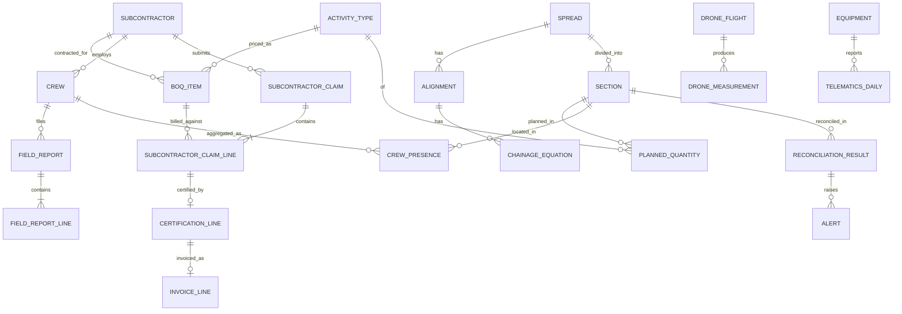

# Synthetic Dataset Specification: `SYN-SPREAD-01`

Owner: data-engineer, with gis-engineer. Version 0.1 (Phase 0). Status: draft for approval.

> **All data generated from this specification is SYNTHETIC.** It represents no real project, company, person, location or contract value. It is used for the MVP demonstration (P6) and for automated tests, and it ships with ground-truth anomaly labels.

## 1. Purpose
- Exercise every MVP epic (E1–E10) end to end without confidential data.
- Provide **known ground truth**, including seeded anomalies, so that the reconciliation engine (E5) and the alerts (AL-01 to AL-08) can be tested for precision and recall.
- Be reproducible from a fixed random seed.

## 2. Scenario parameters

| Parameter | Value | Notes |
|---|---|---|
| Spread ID | `SYN-SPREAD-01` | |
| Length | 25,000 m (KP 000+000 to KP 025+000) | |
| Sections | 25 × 1,000 m, `SYN-SPREAD-01-S01` … `S25` | D-004 |
| Pipe | 24" (610 mm), 12 m joints | ≈ 2,084 joints |
| Calendar | 60 working days, 6-day weeks, start `2027-01-04` (synthetic) | |
| Weather downtime | 4 random full days + 6 half days (seeded) | Productivity × 0 and × 0.5 |
| Subcontractors | `SYN-SUB-A` clearing, grading and reinstatement · `SYN-SUB-B` trenching and backfill · `SYN-SUB-C` welding and coating · `SYN-SUB-D` lowering-in and crossings | |
| Crews | 8 crews, `SYN-CRW-01..08`, mapped to activities | Crew size only, no names |
| Equipment | 40 units, `SYN-EQ-001..040` (excavators, side booms, dozers, graders, welding tractors, padding machine, pipe carriers) | |
| Drone flights | 1 per working day (`SYN-FLT-yyyymmdd`), covering the active front ± 2 km | |
| Random seed | `20270104` | Must be recorded in the generated header |

## 3. Entities and fields

PK = primary key, FK = foreign key. All timestamps are ISO 8601 in UTC; `site_tz` is stored on the spread. Every record carries `source_system`, `created_at`, `record_version` and `is_synthetic = true`.

| Entity | Key fields (PK in bold) | Units / notes |
|---|---|---|
| `spread` | **spread_id**, name, site_tz, crs_code (`SYN-LOCAL`), kp_start_m, kp_end_m | |
| `alignment` | **alignment_id**, spread_id FK, version (`design` / `as-built`), geometry LineStringM, length_m, valid_from | M = KP metres |
| `chainage_equation` | **eq_id**, alignment_id FK, kp_back_m, kp_ahead_m | One synthetic equation at KP 014+200 = 014+050, to test reroute handling |
| `section` | **section_id**, spread_id FK, kp_from_m, kp_to_m (half-open) | |
| `activity_type` | **activity_code** (e.g. `CLR`, `GRD`, `STR`, `WLD`, `NDT`, `FJC`, `TRN`, `LOW`, `BKF`, `HYD`, `RST`), name, sequence_no, uav_observability (Yes / Partial / Time-window / No), verification_source (`UAV` / `LOG` / `NONE`) | From the measurability matrix |
| `boq_item` | **boq_item_id**, subcontractor_id FK, activity_code FK, unit (`m`, `m2`, `m3`, `nr`), unit_rate (synthetic currency `SYN¤`), contract_qty | Synthetic rates only |
| `subcontractor` | **subcontractor_id** (`SYN-SUB-A..D`), scope | |
| `crew` | **crew_id**, subcontractor_id FK, activity_code FK, nominal_size | No personal data |
| `equipment` | **equipment_id**, type, owner (subcontractor_id or `[CONTRACTOR_A]`), telematics_enabled (bool) | 70% telematics-enabled |
| `planned_quantity` | **plan_id**, section_id FK, activity_code FK, planned_qty, unit, planned_start, planned_finish | Baseline schedule |
| `field_report` | **report_id**, report_date, crew_id FK, supervisor_role (role, not a name), submitted_at, sync_status | One per crew per working day |
| `field_report_line` | **line_id**, report_id FK, activity_code FK, kp_from_m, kp_to_m, qty, unit, equipment_ids[], hours_worked, downtime_h, downtime_reason, photo_refs[] | |
| `subcontractor_claim` | **claim_id**, subcontractor_id FK, period_from, period_to, submitted_at, status | Weekly claims |
| `subcontractor_claim_line` | **claim_line_id**, claim_id FK, boq_item_id FK, activity_code, kp_from_m, kp_to_m, work_date, qty_claimed, unit | |
| `drone_flight` | **flight_id**, flight_date, kp_cover_from_m, kp_cover_to_m, gsd_cm, rmse_xy_m, rmse_z_m, n_gcp, n_checkpoints, product_refs (synthetic file names) | |
| `drone_measurement` | **measurement_id**, flight_id FK, activity_code FK, method (`LENGTH_DIGITISE`, `OBJECT_COUNT`, `DSM_DIFF`, `AREA`), kp_from_m, kp_to_m, qty_measured, unit, sigma_qty, footprint geometry, base_flight_id (for DSM_DIFF), quality_flag | Includes uncertainty, E4 |
| `telematics_daily` | **(equipment_id, date)**, engine_hours, idle_hours, working_hours, last_kp_m, data_status (`OK` / `NO_DATA`) | ISO 15143-3-like daily aggregate |
| `crew_presence` | **(crew_id, date, section_id)**, headcount, hours_on_section | **Aggregated crew level only** (D-006). No individual tracks |
| `certification_line` | **cert_line_id**, claim_line_id FK, qty_certified, reconciliation_status, certified_by_role, certified_at, justification | E9 |
| `invoice_line` | **invoice_line_id**, cert_line_id FK, invoice_no, qty_invoiced, amount_syn, invoice_date | E9 |
| `reconciliation_result` | **(section_id, activity_code, work_date, subcontractor_id)**, qty_planned, qty_reported, qty_measured, sigma_measured, qty_claimed, qty_certified, qty_invoiced, tolerance_band, status (`MATCHED` / `WITHIN_TOLERANCE` / `DISCREPANCY` / `UNVERIFIABLE`) | E5 output |
| `alert` | **alert_id**, rule_id (`AL-01..AL-08`), severity, section_id, activity_code, subcontractor_id, crew_id, equipment_id, work_date, explanation, status | E6 |
| `audit_event` | **event_id**, entity, entity_id, action, actor_role, ts, before_hash, after_hash | E10. Append-only |
| `anomaly_ground_truth` | **anomaly_id**, rule_id, entity, entity_id, description | Test oracle. Never exposed in the UI |

### Core ER diagram



Field reports, claim lines and drone measurements link to `section` **spatially**, through KP intervals, rather than through a stored foreign key. This allows pro rata splitting across section boundaries.

## 4. Generation logic

1. **Geometry.**
   - Build a synthetic centreline of 25 km as a smooth polyline in a **synthetic local CRS**: origin (0, 0) at KP 0, with false easting and northing of 500,000 / 1,000,000.
   - It must not correspond to any real location. Add mild curvature with sinusoidal offsets.
   - Insert one chainage equation (§2).
2. **Activity sequence and lags.**
   - Fronts advance in this order: CLR → GRD → STR → WLD → NDT → FJC → TRN → LOW → BKF → RST.
   - Minimum lag between consecutive fronts is 1–3 sections, drawn per activity.
   - Hydrotest (HYD) runs on 2 test sections (KP 0–12.5 and 12.5–25) after BKF completes in each.
3. **Productivity.**
   - Daily output per crew is lognormal around a nominal rate, μ and σ per activity, for example:
     - CLR 900 m/day, σ_log 0.20
     - WLD 30 welds/day, σ_log 0.15
     - TRN 600 m/day, σ_log 0.25
     - LOW 700 m/day, σ_log 0.20
     - BKF 800 m/day, σ_log 0.20
   - Multiply by the weather factor and by a crew efficiency factor ~ U(0.85, 1.10).
4. **True quantity.** The generator holds the "true" work done per day, activity and KP interval. Every observed quantity is derived from it.
5. **Field reports.** Reported qty = true × (1 + ε), with ε ~ N(0, 0.02). Data is 3% late (submitted the next day) and some reports are missing (see AL-02).
6. **Drone measurement noise** by method, applied when the activity is observable in the flight window:
   - `LENGTH_DIGITISE`: σ = 0.5 m + 0.2% of length
   - `OBJECT_COUNT`: miss/extra error ~ Poisson-based, ±1%
   - `AREA`: σ = 1%
   - `DSM_DIFF`: σ_z = 0.04 m, and σV = A·σΔz (the correlated case, per measurability matrix §4)
   - Time-window activities (TRN volume, LOW) are measured only if the flight falls in the window. Probability 0.8 for LOW.
   - `quality_flag = DEGRADED` on 5% of flights (water/vegetation), with σ × 2.
7. **Telematics.** Working hours ≈ crew hours × U(0.7, 0.95). Idle hours are the rest of engine hours. 30% of units have no telematics and are always `NO_DATA`.
8. **Claim bias model**, assigned per subcontractor:

   | Subcontractor | Behaviour |
   |---|---|
   | SYN-SUB-A | Honest: claim = reported ± 1% |
   | SYN-SUB-B | Systematic over-claim of +4% to +8% on TRN/BKF |
   | SYN-SUB-C | Honest, but one duplicated KP range across two weekly claims |
   | SYN-SUB-D | Claims LOW ahead of sequence (before TRN is complete) on 2 occasions, and exceeds the BoQ once |
9. **Certification.** Simulated QS behaviour:
   - Lines that are MATCHED or WITHIN_TOLERANCE are certified at the claimed quantity.
   - Lines with a DISCREPANCY are certified at the measured quantity.
   - UNVERIFIABLE lines are held.
   - The invoice equals the certified amount.

## 5. Seeded anomalies (ground truth)

| Rule | Description | Seeded count | Where |
|---|---|---|---|
| AL-01 | Claimed vs measured beyond tolerance | 12 claim lines | SYN-SUB-B, TRN/BKF, various sections |
| AL-02 | Missing field report (crew active per telematics/presence, but no report) | 6 crew-days | Random crews |
| AL-03 | Duplicate or overlapping KP claim | 3 (1 exact duplicate, 2 partial overlaps ≥ 100 m) | SYN-SUB-C WLD; SYN-SUB-A CLR |
| AL-04 | Cumulative claimed > BoQ or planned quantity | 1 BoQ item | SYN-SUB-D LOW |
| AL-05 | Productivity drop > X% (default X = 40%) vs the 5-day rolling median, not explained by logged weather | 4 crew-days | 2 crews |
| AL-06 | Claimed quantity with no measurement or evidence (UNVERIFIABLE activity with no log reference) | 5 claim lines | Mixed |
| AL-07 | Equipment reported working in a field report, but telematics idle (> 80% idle) or `NO_DATA` on a telematics-enabled unit | 8 equipment-days | Random |
| AL-08 | Out-of-sequence progress (e.g. LOW claimed or reported where TRN is not complete) | 2 | SYN-SUB-D |

Expected detections in automated tests: recall = 1.0 on seeded anomalies. Precision is reported against the noise background, with a target ≥ 0.8, so that thresholds can be tuned. Seeded counts are deliberately small and fixed so that a test failure is easy to diagnose.

## 6. Output files

All files are written to `data/synthetic/`. Every CSV begins with a comment header:
```
# SYNTHETIC DATA - SiteOps Twin demo - not real - seed=20270104 - generator=vX.Y - generated=<UTC>
```
Example file names:
- `SYNTHETIC_spread.csv`, `SYNTHETIC_section.csv`, `SYNTHETIC_activity_type.csv`, `SYNTHETIC_boq_item.csv`, …
- `SYNTHETIC_field_report_line.csv`, `SYNTHETIC_subcontractor_claim_line.csv`, `SYNTHETIC_drone_measurement.csv`, `SYNTHETIC_telematics_daily.csv`, `SYNTHETIC_crew_presence.csv`, `SYNTHETIC_anomaly_ground_truth.csv`
- `SYNTHETIC_alignment.geojson`, `SYNTHETIC_sections.geojson`, `SYNTHETIC_drone_footprints.geojson`. GeoJSON carries `"synthetic": true` and `"crs_note": "SYN-LOCAL synthetic coordinates"` at FeatureCollection level.

Encoding is UTF-8, the decimal point is `.`, and the delimiter is `,`.

## 7. Privacy and labelling rules
- No real names, companies, coordinates, rates or dates linked to a real project.
- People are represented only as **roles** and **crew aggregates**.
- Coordinates are in the synthetic local CRS only. Georeferencing the data to a real place is prohibited.
- Currency is `SYN¤`. Unit rates are drawn from round synthetic ranges, not from market data.
- The `SYNTHETIC` prefix and header are mandatory. The quality-reviewer greps for them at each gate.

## 8. Validation checks (run after generation)
1. Referential integrity: every foreign key resolves.
2. KP intervals are within the spread bounds, with `kp_from < kp_to`. Sections tile the spread without gaps or overlaps.
3. True cumulative quantity per activity is ≤ the planned quantity × 1.05, except the seeded AL-04 case.
4. Activity sequence is respected in the *true* data. Only seeded AL-08 cases violate it in claims or reports.
5. Every seeded anomaly in `anomaly_ground_truth` resolves to an existing record.
6. Summary statistics (mean, std, quantiles) are reported per activity and compared with the generator parameters within ±10%.
7. Re-running with the same seed produces byte-identical files, apart from the `generated` timestamp.
8. Files validate against the `data/templates/*.schema.json` schemas where they exist.
