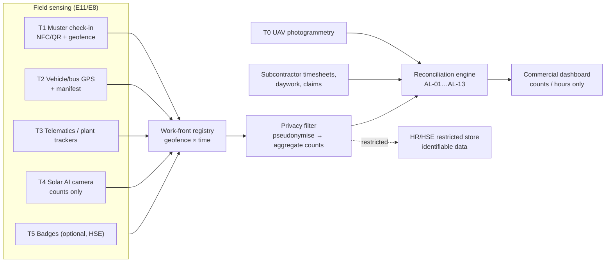

# Field Sensing Layer: Personnel, Equipment and Work-Front Presence Beyond the Drone

Owners: solution-architect and field-operations-specialist. Ethics and legal: research-lead. Commercial controls: commercial-analyst. Version 0.1, added at the user's request (2026-11-23). Proposed decision: **D-069**.

## 1. Why the drone is not enough [F/A]
**[F]** A daily UAV flight is a *snapshot* of *physical progress*. It cannot reliably tell you:
- **how many people** worked at a front, for how long, and for which subcontractor;
- **whether claimed equipment** was on site and working, or idle, on standby or absent;
- **what happened between flights** at the many dispersed, fragmented locations along a spread: crossings, tie-ins, HDD sites, camps, pipe yards, access roads and reinstatement crews.

**[A] A-070.** Practice problems the user reports, to be validated in P3:
- inflated manpower or equipment on subcontractor timesheets, daywork sheets and standby claims;
- "ghost" or double-counted workers across fronts;
- crews reported at a front where no work is visible;
- no independent record of presence at remote, fragmented locations.

These problems hit hardest where payment depends on **time and resources**, not on measured quantity: daywork, manhour-reimbursable items, standby, equipment hire and delay claims.

## 2. Design principle: triangulate presence, minimise personal data [R]
Each commercial fact is checked against **at least two independent signals**, and each signal is collected at the **lowest level of personal intrusion** that still answers the commercial question.

| Commercial question | Signal 1 (claim) | Independent signals (sensing) | Level of personal data needed |
|---|---|---|---|
| How many workers of `[SUBCONTRACTOR_B]` were at front F on day D? | Timesheet, daily report | Muster check-in at the front · gate/camp/bus manifest · camera **people count** · zone badge **count** | **Count per crew, front and hour.** Not who, and not where each person went |
| Was excavator EQ-12 working at KP 12–13? | Equipment daywork sheet | OEM telematics (engine hours, idle) · retrofit GPS tracker · camera equipment count | None (asset data) |
| Was the front active at all between flights? | Daily production report | Bus/vehicle GPS geofence · camera activity index · telematics | None, or aggregated |
| Was the delay or standby real? | Delay/standby claim | Weather station · telematics idle with engine off · camera · access-restriction status | None |

## 3. Sensing options (tiered)

| Tier | Technology | What it gives | Fit for fragmented pipeline sites | Privacy intrusion | Relative cost | Recommendation |
|---|---|---|---|---|---|---|
| T0 | **UAV photogrammetry** (existing) | Physical progress, volumes, equipment snapshot | Covers the ROW once a day | Low (incidental capture of people → blur) | existing | Keep (D-007) |
| T1 | **Structured muster check-in**: NFC/QR badge tap or a foreman roll-call in the app, geofenced to the work front at shift start and end | Headcount and hours per crew/front; attendance trail | Excellent. Works offline. No infrastructure needed | Medium (attendance is usually already collected for payroll and HSE) | Low | **MVP (E11)** |
| T2 | **Vehicle and crew-bus GPS trackers** + digital transport manifest | Which front each crew bus or pickup went to, and when; headcount from the manifest | Excellent for dispersed fronts. Vehicles are the natural unit on a spread | Low (vehicle, not person) | Low | **MVP (E11)** |
| T3 | **Equipment telematics + retrofit GPS/engine-hour trackers** on hired and subcontractor plant | Engine on/idle/off, location, hours | Excellent | None | Low–medium | **MVP (E8, extended to hired plant)** |
| T4 | **Fixed or relocatable solar camera trailers** with edge AI (LTE/LEO satellite backhaul) at high-value fronts: tie-ins, crossings, HDD, pipe yards | Time-lapse; **anonymous people and equipment counts** per 15 min; activity index; security | Good for static or semi-static fronts. Moved as the spread advances | Medium–high. Mitigate with count-only output, faces blurred on the device, short retention | Medium | **Pilot at 2–3 fronts (E11, Should)** |
| T5 | **Wearable badges**: BLE/UWB with gateways, or GNSS + LoRaWAN | Zone-level presence counts; safety (mustering, lone-worker, SOS/man-down, proximity to plant) | Good with mobile gateways on vehicles | High if location tracks are kept. Mitigate with zone counts only and pseudonymised IDs | Medium | **Optional volunteer trial, justified mainly by HSE** |
| T6 | Body-worn / helmet cameras | Inspection evidence | Specific tasks only | High | Medium | Not for presence. Limited QA evidence use only |
| T7 | Facial recognition / biometrics | Identity | n/a | **Very high** (biometric data = special category, GDPR Art. 9) | Medium | **Excluded** |

**[R]** Recommended MVP/pilot sensing set:
- **T1 + T2 + T3** on the whole pilot spread;
- **T4** at 2–3 fixed fronts;
- **T5** only as an optional HSE-led volunteer trial.

This combination covers manpower, equipment and fragmented locations at low intrusion and low cost.

## 4. Fragmented locations: the work-front registry
- **Work-front entity** (`work_front`): ID, type (mainline, tie-in, crossing, HDD, camp, pipe yard, reinstatement), **geofence polygon** (buffered around the KP range or site), active dates and assigned crews. It moves along the KP as the spread advances.
- All presence signals (check-in, vehicle GPS, telematics, camera) are **assigned to a work front by geofence and time**. This answers "what is happening at each location right now" without the drone.
- **Connectivity:**
  - Store-and-forward on the device and on vehicle gateways.
  - LTE where it is available, and LEO satellite terminals on camera trailers and the site office.
  - LoRaWAN gateways on vehicles for badges.
  - Daily sync is enough for commercial use. Near-real-time is a safety bonus.

## 5. New reconciliation rules (proposed alerts)

| ID | Rule | Example (synthetic) |
|---|---|---|
| AL-09 | **Claimed headcount above sensed headcount.** Timesheet or daywork headcount for crew, front and day exceeds the max of (check-in count, manifest count) by more than `[TOL_HEAD]` | Claimed 32 workers; check-in 24, bus manifest 25 → AL-09 (+7) |
| AL-10 | **Impossible presence.** The same badge or worker ID is checked in at two fronts more than `[MIN_TRAVEL_KM]` apart within an impossible travel time, or appears on two subcontractors' timesheets | Badge W-1043 at FRONT-03 07:02 and FRONT-09 (38 km) 07:20 |
| AL-11 | **Claimed equipment hours not supported.** Daywork/hire hours exceed telematics engine-on hours (or GPS presence) by more than `[TOL_EQ_H]` | Claimed 10 h; engine-on 4.5 h |
| AL-12 | **Inactive front reported active.** A report or claim exists for a front where no presence signal is recorded that day (no check-in, vehicle or camera activity) | Reinstatement claimed at FRONT-14; no vehicle or check-in |
| AL-13 | **Standby not supported.** Standby or delay claimed while sensing shows the crew productive elsewhere, or weather data contradicts the claim | Weather standby claimed; site weather station shows wind < limit |

These rules extend AL-01 to AL-08. They support H4 and the proposed H5 (§7).

## 6. Legal, ethical and labour-relations safeguards (mandatory before any pilot)
- **DPIA** under GDPR Art. 35 (or the local equivalent), led by the company DPO, before deployment. Purpose limitation covers commercial verification **and** HSE; there is no performance surveillance of individuals.
- **Jurisdiction check (Q-008).**
  - Italy: Art. 4 of the Workers' Statute (Law 300/1970, as amended in 2015) requires a union agreement or labour-inspectorate authorisation for devices that allow remote monitoring of workers.
  - Other countries: equivalent labour-law and data-protection rules apply. Works-council or worker-representative consultation is required where it applies.
- **Subcontract basis (Q-070).** Presence verification and access to telematics and trackers become **contract clauses** for subcontractors on future contracts. In the pilot, they are agreed in writing.
- **Data minimisation by design:**
  - Commercial users see **counts and hours per crew, front and day**. They never see individual tracks.
  - Individual-level data (badge ID ↔ person) is held by HR/HSE only, pseudonymised, under role-based access.
  - Retention: 90 days for raw location data, 7–30 days for video, 7 years for aggregated commercial evidence. All values are placeholders to be set by the DPIA.
  - Cameras output counts and blurred stills. There is no facial recognition and no audio.
- **Transparency:** signage at camera fronts, worker briefings in the workforce's languages, and an opt-out for voluntary wearable trials.
- **Research ethics:** POLIMI ethics review if required (Q-008). Informed consent for interviews and the wearable trial. The researcher never accesses identifiable presence data. The research uses anonymised aggregates only.
- **Security:** device hardening, encrypted transport, segregated network (IEC 62443), and an asset register for devices.

## 7. Research implications
- **H4** is strengthened: presence signals give earlier and more objective detection of slowdowns at dispersed fronts.
- **Proposed H5 (D-070):** *Structured presence sensing (check-in, vehicle GPS, telematics, cameras) reduces the discrepancy between claimed and independently verified manpower and equipment hours.*
  - DV: |claimed − verified| / verified, for headcount-days and equipment-hours.
  - Design: baseline vs pilot, plus a parallel audit sample.
  - Decision rule: median discrepancy falls by 30% or more.
- **RQ5** (adoption conditions) gains a strong labour-relations and privacy component. This is a likely novel contribution, because the literature on remote pipeline spreads is thin here (gap candidate G-new).

## 8. Architecture and scope changes proposed
- New epic **E11: Field presence sensing** (MVP: T1 muster check-in, T2 vehicle GPS/manifest import, work-front registry and geofencing, AL-09 to AL-12; Should: T4 camera-count import, AL-13). E8 is extended to hired and subcontractor plant trackers.
- New data entities: `work_front`, `presence_event` (pseudonymised), `presence_count_hourly` (aggregate), `vehicle_trip`, `transport_manifest`, `camera_count`, `weather_obs`.
- **D-006 revision:** keep "no individual tracks visible to commercial users", and allow individual check-in data under HR/HSE control (D-069).
- Synthetic data: add presence and vehicle data, with seeded AL-09 to AL-13 cases (inflated headcount, ghost badge, unsupported equipment hours, inactive front).
- The MVP effort grows by about 3–4 developer-weeks (A-071). Together with R-40, the scope decision at D-005 becomes more important.

## 9. Approved sensing level: maximum feasible for the German market (D-073, user decision 2026-11-23)
The user asked for **the highest level of sensing currently reachable** with commercially available sensors, matched to the needs of German clients. The design therefore covers every tier that is legally deployable in Germany, together with the safeguards in `01_governance/germany_context.md`.

| Tier | Sensor | Status in the MVP demo (synthetic) | Live deployment condition (Germany) |
|---|---|---|---|
| T0 | UAV photogrammetry (existing) | ✅ Implemented: daily flights, σ per measurement | Existing permits |
| T1 | Muster check-in (NFC/QR, geofenced) | ✅ `presence_daily.checkin_count` | Works agreement (BetrVG §87(1) No. 6) + DPIA |
| T2 | Crew-bus/vehicle GPS + digital manifest | ✅ `vehicle_trip`, `manifest_count` | Works agreement (vehicles assigned to crews) |
| T3 | OEM telematics (ISO 15143-3) + retrofit trackers on hired plant | ✅ `telematics_daily`, AL-07, AL-11 | Hire contracts give data access; operator-linked data counts as employee data |
| T4 | Solar AI camera trailers, count-only | ✅ `camera_max` at 3 fronts | BDSG §4 / GDPR, signage, short retention, works agreement |
| T5 | UWB/BLE + GNSS/LoRaWAN badges, zone counts, pseudonymised | ✅ `badge_event`, AL-10 | Works agreement; HSE purpose (mustering, lone worker) as the primary justification |
| T8 | **3D GNSS machine control** on excavators: as-built trench depth and length | Roadmap (data model ready: add as a `measurement.source`) | Contractor- or hire-owned systems; export logs |
| T9 | **Digital weld and pipe-joint traceability**: welding-machine parameter logs, joint QR/RFID tags | Partly: QA weld log is the LOG source for WLD/FJC | QA/QC system export (Q-054) |
| T10 | **Site weather station** | ✅ `weather_obs`, AL-13 | None |
| T11 | Mobile LiDAR / GNSS rover as-built survey | ✅ As-built survey for LOW (`ASBUILT_SURVEY`) | Existing survey crew |
| T7 | Facial recognition / biometrics | ❌ Excluded | Not proportionate (GDPR Art. 9) |

H5 is **approved** (D-070). The demo already produces H5's dependent variables: headcount and equipment-hour discrepancy.
