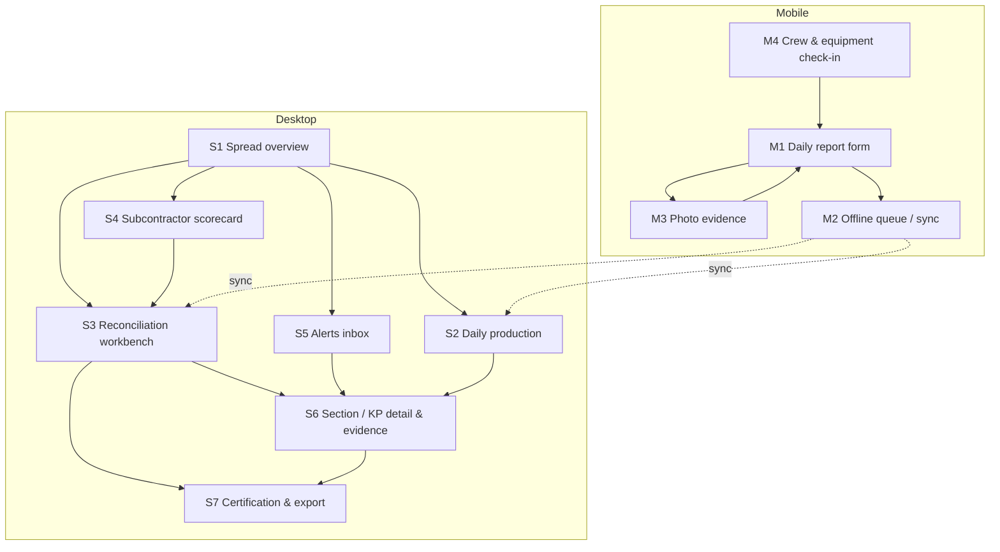

# Dashboard and Mobile Wireframe Description

**Owner:** ux-designer. Version 0.1 (Phase 0, low fidelity). Stories: [`mvp_backlog.md`](mvp_backlog.md).
All values shown are **SYNTHETIC**.

## 1. Design principles

| Context | Principle | Concrete rule |
|---|---|---|
| Field (mobile) | Gloves and dust | Touch targets ≥ 48 × 48 px with ≥ 8 px spacing; steppers, pickers and numeric keypads; no small check-boxes |
| Field | Sunlight | High-contrast theme (text contrast ≥ 7:1 target, ≥ 4.5:1 minimum); no information shown only by colour; large type (≥ 16 px body, ≥ 20 px for quantities) |
| Field | Minimal typing | Defaults from yesterday (E2-03); "use GPS" for KP; voice-to-text optional for comments; ≤ 3 screens per report |
| Field | Offline is normal | Every screen works offline; a persistent sync indicator; nothing is lost on app kill |
| Field | Safety | No time-critical prompts; no phone use required while operating equipment |
| Desktop | Exception-first | Default views are filtered to DISCREPANCY, UNVERIFIABLE and open alerts. Users drill down from a red section, not from a full table |
| Desktop | One click to evidence | Every number links to its source record (S6) |
| Desktop | Show uncertainty | Measured quantities always show ±U and the quality flag |
| Both | Traceability | Every edit shows who and when; overrides are visually flagged |

## 2. Status semantics (colour-blind safe)

The status is always encoded **three ways: colour + icon + text label**. The palette below is the Okabe–Ito colour-blind-safe set.

| Status | Colour (token) | Icon | Label |
|---|---|---|---|
| MATCHED | `--status-ok` blue-green #009E73 | ✔ (check) | "Matched" |
| WITHIN_TOLERANCE | `--status-tol` sky blue #56B4E9 | ≈ (approx) | "Within tol." |
| DISCREPANCY | `--status-bad` vermillion #D55E00 | ▲ (triangle) | "Discrepancy" |
| UNVERIFIABLE | `--status-unk` grey #7F7F7F with hatched pattern | ? (question) | "Unverifiable" |
| No data / no flight | outline only | ⊘ | "No coverage" |
| Override applied | purple outline #CC79A7 | ✎ | "Override" |

Alert severity uses HIGH ▲▲, MEDIUM ▲ and LOW ●, always with a text label.

## 3. Navigation flow



## 4. Desktop screens

### S1. Spread overview
- **Purpose:** in one minute, see where production and claims are off.
- **Primary persona:** CM, plus SM and QS.
- **Stories:** E7-01, E4-03, E6-*.

```
┌──────────────────────────────────────────────────────────────────────────────────┐
│ SiteOps Twin · [SPREAD_ID] (SYNTHETIC)   Date ◀ 2027-03-10 ▶   Subcontr. [All ▾] │
├──────────────┬──────────────┬──────────────┬──────────────┬──────────────────────┤
│ Claimed vs   │ Open alerts  │ Claims       │ Certified to │ Data completeness    │
│ measured     │ ▲▲ 3 ▲ 7 ● 4 │ verified     │ date (value) │ reports 7/8 · flight │
│ +4.2 %       │              │ 86 %         │ [CUR] x.xx M │ coverage 5/6 sections│
├──────────────┴──────────────┴──────────────┴──────────────┴──────────────────────┤
│ KP STRIP  KP 000 ─────────────────────────────────────────────────────── KP 020  │
│ Activity  │S01│S02│S03│S04│S05│S06│S07│S08│S09│S10│ ... │S20│                    │
│ Clearing  │ ✔ │ ✔ │ ✔ │ ✔ │ ≈ │ ✔ │ ✔ │ ✔ │ ✔ │ ✔ │     │ ⊘ │                    │
│ Trench    │ ✔ │ ✔ │ ≈ │ ✔ │ ✔ │ ✔ │ ▲ │ ? │   │   │     │   │                    │
│ Welding   │ ✔ │ ✔ │ ✔ │ ≈ │ ✔ │ ✔ │ ✔ │   │   │   │     │   │                    │
│ Lowering  │ ✔ │ ≈ │ ✔ │ ▲ │   │   │   │   │   │   │     │   │                    │
│ Backfill  │ ✔ │ ✔ │ ? │   │   │   │   │   │   │   │     │   │                    │
├──────────────────────────────────────────┬───────────────────────────────────────┤
│ MAP (orthophoto basemap, synthetic)      │ TOP EXCEPTIONS (click → S6)           │
│  ── centreline with KP ticks             │ ▲▲ S07 Trench  claim +100 m³ (+10%)   │
│  ▒▒ section polygons coloured by status  │ ▲▲ S04 Lowering overlap 200 m (AL-03) │
│  ◉ crew markers (crew-level, CR-03 …)    │ ▲  S08 Trench  unverifiable (AL-06)   │
│  ▣ equipment markers                     │ ▲  CR-05 welding −35 % (AL-05)        │
│  ⊘ hatched = no flight coverage          │ [View all alerts → S5]                │
└──────────────────────────────────────────┴───────────────────────────────────────┘
```
- **Interactions:**
  - Clicking a strip cell filters S3 to that activity × section.
  - Hovering shows the C, M ± U and variance values.
  - Date arrows step through the days.
  - The map and the strip are linked, so selecting a section highlights it in both.
- **States:**
  - *Empty:* "No data for this date. Check flight and report imports."
  - *Loading:* skeleton tiles.
  - *Stale:* a banner "Last flight import 2 days old".
  - *Error:* tile-level error with retry. The rest of the page stays usable.

### S2. Daily production
- **Purpose:** production vs plan by activity, section and crew. Productivity.
- **Persona:** SM, PL.
- **Stories:** E7-02, E2-05, E6-02, E6-05.

```
┌ Daily production · 2027-03-10 ─────────────────────────── [Approve pending (1)] ┐
│ Activity      Unit  Planned  Reported  Measured(±U)    Var vs plan  Unit/crew-h │
│ Trench exc.   m³    1,200    1,080     1,000 ±30        −10 %        6.8         │
│ Welding       jt    45       26        26 (QA log)      −42 % ▲      1.9 ▲ AL-05 │
│ Lowering-in   m     500      520       505 ±5           +4 %         …           │
├──────────────────────────────────────────────────────────────────────────────────┤
│ By crew: CR-03 S07 ✔ report approved · CR-05 S04 ▲ AL-05 (delay WEATHER 2.5 h)   │
│          CR-07 S08 ⚠ AL-02 no report by 20:00                                    │
│ [Chart: 14-day production trend per activity with plan line]                     │
└──────────────────────────────────────────────────────────────────────────────────┘
```
- **States:**
  - Reports pending approval are shown greyed out, with the label "pending".
  - *Offline / desktop:* not applicable.
  - *Empty:* "No approved reports yet".

### S3. Reconciliation workbench
- **Purpose:** decide each claim line, exception-first.
- **Persona:** QS, plus CM.
- **Stories:** E7-03, E5-01..04, E6-01/03/06, E9-01.

```
┌ Reconciliation · [SUBCONTRACTOR_B] · March 2027 ── Filter: Status [Discrepancy ▾] Activity [All ▾] Section [All ▾] ┐
│ ☐ Key (act·sect·date)     Planned Reported Measured±U  Claimed Certified Invoiced  Var(C−M)   Status        Evid. │
│ ☐ Trench·S07·03-10        1,200   1,080    1,000±30    1,100   –         –         +100 (+10%) ▲ Discrepancy  📎3 │
│ ☐ Lowering·S04·03-09      500     520      505±5       520     –         –         +15 (+3%)   ▲ Overlap AL-03 📎2│
│ ☐ Trench·S08·03-10        800     760      —           780     –         –         n/a         ? Unverifiable 📎0│
│ ☐ Backfill·S02·03-08      900     890      880±25      900     900 ✎     –         +20 (+2%)   ≈ Within tol.  📎4│
├──────────────────────────────────────────────────────────────────────────────────────────────────────────────────┤
│ Selected: 1 · Certifiable cap: 1,060 m³ · [Certify at cap] [Certify other… (override)] [Hold] [Export CSV]       │
└──────────────────────────────────────────────────────────────────────────────────────────────────────────────────┘
```
- **Interactions:**
  - The table is sorted by |variance| (descending) by default.
  - Bulk-certify is allowed only for MATCHED and WITHIN_TOLERANCE lines.
  - "Certify other" opens the override dialog (reason code plus a mandatory comment).
  - 📎 opens S6.
  - A toggle switches between **period** and **cumulative-to-date** views.
- **States:**
  - *Empty filter:* "No discrepancies 🎉. Show all lines?"
  - *Recalculating:* row spinners. The decision buttons are disabled until the recalculation completes.

### S4. Subcontractor scorecard
- **Persona:** CM.
- **Stories:** E7-04.
- **Components:**
  - a status-mix stacked bar (with text percentages)
  - over-claim value
  - duplicates count
  - mean claim → certification days
  - override count
  - a 12-week trend sparkline
  - a comparison against the spread average

```
┌ [SUBCONTRACTOR_B] · scorecard · Mar 2027 ───────────────────────────────┐
│ Status mix  ✔ 62 %  ≈ 21 %  ▲ 11 %  ? 6 %   ████████▒▒▒▒▓▓░             │
│ Over-claim (claimed − certified)  [CUR] xx k   · Duplicates (AL-03) 2   │
│ Claim → certification  4.1 days (spread avg 5.3) · Overrides 1           │
│ Trend (12 wk discrepancy %)  ▁▂▃▂▂▁▁▂▁▁▁▁                                │
└──────────────────────────────────────────────────────────────────────────┘
```
- **States:** fewer than 2 weeks of data shows "Insufficient history".

### S5. Alerts inbox
- **Persona:** QS, SM, CM.
- **Stories:** E6-01..09.

```
┌ Alerts ── [Open ▾] [Severity ▾] [Type AL-01..08 ▾] [Assigned to me] ─────────────┐
│ ▲▲ HIGH  AL-01  S07 Trench  Claimed exceeds M+U+T by 40 m³      QS1  2h  [Open]  │
│ ▲▲ HIGH  AL-03  S04 Lowering overlap 200 m KP 012+400–600       QS1  1d  [Open]  │
│ ▲  MED   AL-05  CR-05 welding −35 % vs 5-day median · WEATHER   SM   5h  [Open]  │
│ ●  LOW   AL-07  EQ-112 reported 10.0 h vs telematics 1.5 h       SM   1d  [Open]  │
│ Detail pane: rule, inputs, numbers, evidence links → [Assign] [Resolve: reason ▾] │
└──────────────────────────────────────────────────────────────────────────────────┘
```
- Each alert explains **why it fired**: the rule, the parameters and the inputs.
- Resolving an alert needs a reason code.

### S6. Section / KP detail and evidence
- **Persona:** QS, CM, SV.
- **Stories:** E7-06, E4-01/02, E10-01.

```
┌ S07 · KP 006+000–007+000 · Trench excavation · 2027-03-10 ─────────────────────┐
│ [Orthophoto tile FL-2027-03-10-A, synthetic]   │ Measurement                     │
│  ── centreline   ▒ trench footprint            │ 1,000 m³ ± 30 (95 %)            │
│  ● photo pins (geo/time-stamped)               │ Method: DSM diff (03-09 → 03-10)│
│                                                │ Flight QA: RMSEz 0.03 m ✔ PASS  │
├────────────────────────────────────────────────┼─────────────────────────────────┤
│ Field report (CR-03, approved SM): 1,080 m³    │ Claim [SUBCONTRACTOR_B]: 1,100  │
│ Photos (4): thumbnails with time + KP          │ Status ▲ Discrepancy · cap 1,060│
├────────────────────────────────────────────────┴─────────────────────────────────┤
│ Audit history: 03-10 18:02 FM created · 03-10 19:40 SM approved ·               │
│ 03-11 08:15 SC claim uploaded (hash ab12…) · 03-11 08:16 engine: DISCREPANCY     │
└──────────────────────────────────────────────────────────────────────────────────┘
```
- **States:**
  - *Failed flight:* the measurement panel shows "Excluded – RMSE 0.08 m > 0.05 m".
  - *No photos:* "No photo evidence in KP range".

### S7. Certification and export
- **Persona:** QS (prepares), CM (approves overrides), FIN (views).
- **Stories:** E9-01..03, E5-03.

```
┌ Certificate draft · [SUBCONTRACTOR_B] · Period 2027-03 ── DRAFT – excludes retention, advances, variations, tax ┐
│ BoQ item  Description              Unit  Prev cum  This period  Cum     Rate        Amount     Flags          │
│ B-2.1     Trench excavation        m³    4,200     1,950        6,150   [RATE_B21]  [calc]     ✎ 1 override   │
│ B-3.4     Lowering-in              m     2,800     1,100        3,900   [RATE_B34]  [calc]                    │
│ Totals reconcile to certified lines ✔ · Open discrepancies in period: 2 ▲                                      │
│ [Request CM approval (overrides)]  [Export CSV]  [Export PDF]  [Record invoice (FIN)]                          │
└────────────────────────────────────────────────────────────────────────────────────────────────────────────────┘
```
- **States:**
  - Export is disabled while overrides above `[OVERRIDE_CM_VALUE]` are not approved.
  - An invoice mismatch shows a banner (E9-03).

## 5. Mobile screens

### M1. Daily report form
- **Persona:** FM.
- **Stories:** E2-01..05.
- **Target:** ≤ 5 min median.

```
┌────────────────────────────┐
│ ● Offline · 3 queued    ⟳  │
│ Report 2027-03-10 · CR-03  │
│ Section [S07 ▾] (prefilled)│
│ ┌ Activity line 1 ───────┐ │
│ │ Activity [Trench ▾]    │ │
│ │ KP from [006+200] 📍GPS│ │
│ │ KP to   [006+650] 📍GPS│ │
│ │ Qty  [ − ] 1,080 [ + ] │ │
│ │ Unit m³ (auto)         │ │
│ │ Equip ☑EQ-112 ☑EQ-115  │ │
│ │ Hours [ − ] 10 [ + ]   │ │
│ └────────────────────────┘ │
│ [+ Add line] [📷 Photos 2] │
│ Delays [WEATHER ▾] 2.5 h   │
│ ┌────────────────────────┐ │
│ │      SUBMIT REPORT     │ │  ← 56 px tall, full width
│ └────────────────────────┘ │
└────────────────────────────┘
```
- **Validation:**
  - KP outside the section ± 200 m triggers a confirmation prompt.
  - A quantity more than 3× the crew's 5-day median triggers a soft warning ("check units").
- **States:**
  - *Offline:* a banner. Submit puts the report in the queue.
  - *Returned by SM:* a red label with the SM's comment, and the report opens for editing.

### M2. Offline queue and sync conflicts
- **Persona:** FM.
- **Stories:** E2-02.
- **Content:**
  - the list of queued items (reports, photos), with their size
  - the last sync time
  - a "Sync now" button
  - a conflict card
- **Conflict rule [A] A-061:** the server version wins for approved records. For pending records, the device version is kept as a new version, and the user sees "Your edit saved as v2. SM will review".
- **States:**
  - *Syncing:* a progress bar.
  - *Failed:* retries with backoff, and the message "Data is safe on this device".
  - *Storage nearly full:* a warning at 80%.

### M3. Photo evidence
- **Persona:** FM, SV.
- **Stories:** E2-01, E6-06, E7-06.
- **Behaviour:**
  - The camera opens with a KP and time overlay.
  - GPS is required. Without a fix, the photo is tagged "no GPS", and the KP is entered manually and marked as such.
  - Photos are compressed to ≤ 500 kB.
  - A photo is linked to an activity line.
  - No faces are required. A hint reads "avoid capturing people's faces".

### M4. Crew and equipment check-in (crew level)
- **Persona:** FM.
- **Stories:** E8-01, E8-03.

```
┌────────────────────────────┐
│ Check-in · 06:30 · S07     │
│ Crew CR-03                 │
│ Headcount [ − ] 14 [ + ]   │
│ Equipment                  │
│  ☑ EQ-112 Excavator        │
│  ☑ EQ-115 Excavator        │
│  ☐ EQ-201 Sideboom         │
│ ┌────────────────────────┐ │
│ │       CHECK IN          │ │
│ └────────────────────────┘ │
│ ℹ Crew-level only. No       │
│   individual tracking.     │
└────────────────────────────┘
```
- Check-out at shift end mirrors check-in.
- No names. Headcount only (D-006).

## 6. Accessibility (WCAG 2.1 AA)

| Area | Requirement |
|---|---|
| Contrast | Text contrast ≥ 4.5:1 (≥ 3:1 for large text and UI components); field theme targets 7:1 |
| Colour | Status is never conveyed by colour alone (§2) |
| Keyboard | All desktop actions are reachable by keyboard; visible focus; the workbench supports keyboard row navigation |
| Screen readers | Table headers are marked up; status icons have text alternatives; charts have data-table alternatives |
| Touch | Targets ≥ 48 px; no gestures required other than tap and scroll |
| Text | Text can be resized to 200% without loss of content; units are always shown next to numbers |
| Time | No timeouts that lose data; sessions auto-save drafts |

## 7. Usability test plan hook (for P6/P7)
- **Tasks:**
  - M1: submit a 3-line report offline.
  - S3: find and decide the largest discrepancy.
  - S7: produce a certificate draft.
- **Metrics:**
  - time on task (H2)
  - error rate
  - SUS ≥ 68 (SC4)
