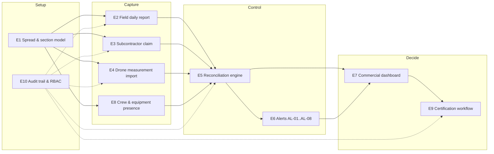

# MVP Backlog: User Stories, Acceptance Criteria and Reconciliation Controls

**Owners:** ux-designer and commercial-analyst. Field-operations-specialist review is recorded in §8.
**Version:** 0.1 (Phase 0 draft, for user confirmation under D-005).
**Machine-readable copy:** [`mvp_backlog.csv`](mvp_backlog.csv).

> **Notes on the data in this file**
> - All numeric examples use **synthetic data** (`SYNTHETIC` spread `[SPREAD_ID]`, sections `S-01` to `S-20`).
> - Story points are **[A] A-060**: relative estimates (Fibonacci), to be re-estimated by the full-stack-developer in P4.
> - Tolerance parameters in brackets (for example `[TOL_VOL_PCT]`) are placeholders. They are configured from the contract's measurement rules (Q-007).

## 1. Personas

| Code | Persona | Goals | Work context | Devices | Main pain points today |
|---|---|---|---|---|---|
| CM | Commercial Manager | Certify only what was built; no overpayment; defensible numbers in disputes; fast monthly close | Site office or head office, under period-end pressure | Laptop, two screens | Quantities arrive late from several unlinked sources; disputes are argued from memory and spreadsheets |
| QS | Quantity Surveyor | Reconcile claims against evidence line by line; produce certificates quickly | Site office, with occasional ROW visits | Laptop, tablet | Re-keying subcontractor reports; hunting for evidence; arithmetic and duplicate errors |
| SM | Spread / Site Manager | Know daily where each crew is and what it produced; spot slowdowns early | Moving along the ROW in a vehicle | Rugged phone or tablet, laptop in the evening | Production figures arrive the next day; no single view across sections |
| FM | Foreman / section supervisor | Report the day's work fast and get on with the job | On the ROW: dust, heat, gloves, poor signal | Rugged phone (shared tablet as a fallback) | Paper forms; repeated questions from the office; reports disputed later |
| SV | Survey / Drone lead | Deliver flights and measurements that the commercial team actually uses | ROW plus processing workstation | Workstation running `[DRONE_SW]` | Volumes are delivered as PDFs and not linked to claims or sections |
| SC | Subcontractor representative | Get claims accepted and paid quickly with fewer arguments | Own site office | Laptop or phone | Claims rejected late without clear reasons; payment delays |
| PL | Planner | Planned vs actual by section, for schedule updates and earned value (EV) | Office | Laptop | Progress data is inconsistent with commercial data |
| FIN | Finance | Pay invoices that match certified quantities | Head office | Laptop | Invoices do not match certificates; resubmissions |
| ADM | Administrator | Configure the spread, users and roles; keep data clean | Office | Laptop | none (new role) |

## 2. Story map



**Walking skeleton (thinnest end-to-end slice):**

> E1-01 → E1-02 → E2-01 → E3-01 → E4-01 → E5-01 → E6-01 → E7-03 → E9-01 → E10-01.

## 3. Core rules used by the acceptance criteria

### 3.1 Quantity states (D-008)

> **Planned** (BoQ / schedule) → **Reported** (field, FM) → **Measured** (independent source) → **Claimed** (SC) → **Certified** (QS) → **Invoiced** (FIN)

Every quantity record is keyed on **activity × section × date × subcontractor**, and also carries `kp_from`, `kp_to` and its provenance.

**Measured = independent source.** Which source counts as independent is set per activity by the measurability matrix (`../geospatial/quantity_measurability_matrix.md`):
- **Drone or survey** for observable earthworks and linear progress: clearing, grading, trench, backfill, stringing, reinstatement.
- **The QA/QC record** for weld count, NDT and field-joint coating (A-014).
- **The test-pack record** for hydrotest.

### 3.2 Reconciliation status

For a key with claimed quantity **C**, independent measured quantity **M**, measurement uncertainty **U** (± at the reported confidence level, taken from the measurement record) and contractual tolerance **T = max(`[TOL_<UNIT>_ABS]`, `[TOL_<UNIT>_PCT]` × M)**:

| Status | Rule | Default commercial treatment |
|---|---|---|
| `MATCHED` | \|C − M\| ≤ U | Eligible to certify the claimed quantity |
| `WITHIN_TOLERANCE` | U < \|C − M\| ≤ U + T | Eligible to certify. QS confirms. The variance is logged |
| `DISCREPANCY` | \|C − M\| > U + T | Not certifiable above M + U + T unless a QS override with a reason code |
| `UNVERIFIABLE` | No valid M within `[MEAS_WINDOW_DAYS]`, and no accepted alternative evidence | Held. Raises AL-06. Certify only by override |

**Worked example** (synthetic: trench excavation, S-07, 2027-03-10; `[TOL_VOL_PCT]` = 3%; U = ±30 m³):

| Claim C | M | \|C − M\| | U + T | Status |
|---|---|---|---|---|
| 1,020 m³ | 1,000 m³ | 20 | 30 + 30 = 60 | `MATCHED` |
| 1,050 m³ | 1,000 m³ | 50 | 60 | `WITHIN_TOLERANCE` |
| 1,100 m³ | 1,000 m³ | 100 | 60 | `DISCREPANCY`. Certifiable cap without override: 1,060 m³ |

**Note:** the claim must be **over-measured** for this rule to bite. An under-claim (C < M) is reported, but it never causes the platform to certify more than C.

### 3.3 Period vs cumulative
- Certificates are based on **cumulative-to-date** quantities.
- **Period quantity** = cumulative certified this period − cumulative certified previous period.
- Both views must agree to within rounding (± 0.01 unit).

### 3.4 Out of MVP scope (commercial)
The MVP does not cover:
- retention
- advance-payment recovery
- price adjustment / escalation
- variations and change orders, other than a flag
- back-charges
- tax
- currency conversion

The certificate draft carries quantities × rates only. Commercial adjustments stay in `[ERP_SYSTEM]`.

## 4. User stories and acceptance criteria

Legend:
- **Priority (MoSCoW):** M = Must, S = Should, C = Could.
- **MVP:** **Y** = in the MVP, N = roadmap.
- **H** = the hypothesis the story supports.
- **PP** = pain-point category:
  - DATA: fragmented sources
  - TIME: latency
  - DISP: disputes
  - EVID: missing evidence
  - DUP: duplicates
  - VIS: low visibility
  - ADM: admin rework
  - These categories are mapped to the IDs in `03_as_is_analysis/pain_point_register.csv` in P3 (Q-061).

### E1. Spread and section model

**US-E1-01** · ADM · M · 3 pts · MVP Y · H1, H2 · PP DATA
As an administrator, I want to import a synthetic pipeline centreline with KP stationing, so that every record can be located by chainage.
```gherkin
Given a GeoJSON or LandXML centreline of 20.000 km, with KP 000+000 at its start
When I import it
Then the system stores it as one alignment, with total length 20,000 m ± 1 m
And any point within [ROW_BUFFER_M] = 30 m of the line returns its KP to the nearest metre
And a point farther than 30 m is rejected with the error "outside ROW buffer"
```

**US-E1-02** · ADM · M · 2 pts · MVP Y · H1 · PP DATA
As an administrator, I want to divide the alignment into sections of `[SECTION_LENGTH_M]`, so that quantities aggregate to comparable units.
```gherkin
Given the 20.000 km alignment and SECTION_LENGTH_M = 1000
When I generate sections
Then 20 sections S-01..S-20 are created, contiguous, with no gaps or overlaps
And S-07 spans KP 006+000 to 007+000
```

**US-E1-03** · QS · M · 3 pts · MVP Y · H1, H4 · PP DATA
As a QS, I want an activity catalogue with unit, measurement method, independent source and predecessor activity, so that reconciliation and sequence checks use contract rules.
```gherkin
Given the catalogue holds 12 activities (clearing to reinstatement)
When I view "lowering-in"
Then I see unit = m, independent_source = drone+photo, predecessor = trench excavation
And no activity can be saved without a unit and an independent source
```

**US-E1-04** · QS · M · 3 pts · MVP Y · H1, H3 · PP DISP
As a QS, I want to map BoQ items to activities and subcontracts, with contracted quantity and unit rate, so that claims can be valued and capped.
```gherkin
Given BoQ item "B-2.1 Trench excavation, normal soil" with 12,000 m³ at rate [RATE_B21]
When I map it to activity "trench excavation" and subcontract [SUBCONTRACTOR_B]
Then claims by [SUBCONTRACTOR_B] for that activity are valued at [RATE_B21]
And a claim for an activity with no BoQ mapping is rejected with "unmapped activity"
```

### E2. Field daily report capture

**US-E2-01** · FM · M · 5 pts · MVP Y · H2, H4 · PP TIME, DATA
As a foreman, I want to submit my daily report on a phone in under 5 minutes, so that reporting does not take me away from the crew.
```gherkin
Given a foreman with an assigned crew and section
When the foreman completes a report with 3 activity lines, 2 photos and 1 delay
Then the median completion time across UAT participants is ≤ 5 min (90th percentile ≤ 8 min)
And each activity line requires: activity, KP from–to, quantity, unit (auto), crew, equipment, hours
And KP from–to values outside the assigned section ± [KP_SLACK_M] = 200 m trigger a confirmation prompt
```

**US-E2-02** · FM · M · 5 pts · MVP Y · H2 · PP DATA
As a foreman, I want to capture reports with no signal, so that I can work anywhere on the ROW.
```gherkin
Given the device is in airplane mode
When the foreman creates 1 shift's reports (≥ 6 activity lines and ≥ 10 photos)
Then all records are stored locally, with a device timestamp (UTC) and "pending sync" status
And when connectivity returns, they sync within 2 min, with no data loss and no duplicates
```

**US-E2-03** · FM · S · 2 pts · MVP Y · H2 · PP TIME
As a foreman, I want today's report prefilled from yesterday's crew, equipment and section, so that I only change what changed.
```gherkin
Given yesterday's report for crew CR-03 at S-07 with equipment EQ-112 and EQ-115
When the foreman starts today's report
Then crew, section and equipment are prefilled and quantities are blank
```

**US-E2-04** · FM · M · 2 pts · MVP Y · H4 · PP VIS
As a foreman, I want to record delays with standard codes (weather, access, material, breakdown, HSE stop, other), so that slowdowns have causes attached.
```gherkin
Given a delay of 2.5 h with code WEATHER
When the report is submitted
Then the delay is stored against crew, section and date
And AL-05 alerts for that crew and date show the annotation "delay logged: WEATHER 2.5 h"
```

**US-E2-05** · SM · M · 3 pts · MVP Y · H2 · PP TIME
As a site manager, I want to review and approve field reports by `[REPORT_CUTOFF]`, so that reported quantities become the official daily production.
```gherkin
Given 8 field reports submitted for 2027-03-10
When the SM approves 7 and returns 1 with a comment
Then the 7 reports' quantities change state to Reported (approved)
And the returned report notifies its foreman and stays out of the daily production total
```

### E3. Subcontractor daily claim

**US-E3-01** · SC · M · 3 pts · MVP Y · H1, H3 · PP DISP, ADM
As a subcontractor representative, I want to submit daily claimed quantities through a form or a CSV template, so that my claims are recorded once and in the right structure.
```gherkin
Given the CSV template claim_template.csv with columns date, activity, kp_from, kp_to, qty, unit, crew_ref, evidence_ref
When [SUBCONTRACTOR_B] uploads a file with 25 valid rows
Then 25 claim lines are created with state Claimed and source = SC upload
And the upload receipt shows the count, total quantity per activity, and a file hash
```

**US-E3-02** · QS · M · 3 pts · MVP Y · H1 · PP ADM
As a QS, I want imported claims validated automatically, so that I do not re-key or chase format errors.
```gherkin
Given an upload with 25 rows, where 2 have kp_to < kp_from and 1 has unit "m" for a m³ activity
When validation runs
Then 22 rows are accepted and 3 are rejected, with row-level reasons
And no partially valid row is stored
```

**US-E3-03** · SC · S · 2 pts · MVP Y · H3 · PP DISP
As a subcontractor representative, I want to see the reconciliation status of my claim lines, so that I can fix issues before the period closes.
```gherkin
Given a claim line has status DISCREPANCY
When the SC views their claims
Then they see the status, the variance and the reason code
And they do not see other subcontractors' data or internal comments
```

### E4. Drone measurement import

**US-E4-01** · SV · M · 5 pts · MVP Y · H1 · PP EVID, DATA
As the survey lead, I want to import per-flight measurements per section and activity, with uncertainty and footprint, so that independent quantities sit next to claims.
```gherkin
Given a measurement file for flight FL-2027-03-10-A with 14 rows (section, activity, qty, unit, uncertainty_pm, method, surface_pair)
And a footprint polygon (GeoJSON)
When I import it
Then 14 Measured records are created, linked to flight FL-2027-03-10-A and its capture time (UTC)
And rows without uncertainty_pm are rejected
And sections outside the footprint receive no Measured record for that flight
```

**US-E4-02** · SV · M · 2 pts · MVP Y · H1 · PP EVID
As the survey lead, I want each flight to carry an accuracy check (RMSE at check points) and to exclude flights that fail tolerance, so that poor data never drives certification.
```gherkin
Given [MAX_RMSE_Z_M] = 0.05 and a flight with vertical RMSE 0.08 m
When the flight is imported
Then its measurements get the quality flag FAIL
And they are excluded from reconciliation, with the reason visible in S6
```

**US-E4-03** · CM · S · 2 pts · MVP Y · H2 · PP VIS
As the Commercial Manager, I want to see which active sections the latest flights did not cover, so that I know where measurement is missing.
```gherkin
Given 6 sections have activity on 2027-03-10 and the flight footprint covers 5
When I open S1
Then the uncovered section is marked "No flight coverage", with icon ⊘ and a text label
```

### E5. Reconciliation engine

**US-E5-01** · QS · M · 8 pts · MVP Y · H1, H3 · PP DISP
As a QS, I want the system to compute reconciliation status per activity × section × date × subcontractor, so that I review exceptions instead of every line.
```gherkin
Given the trench excavation example in §3.2 (M = 1,000, U = 30, TOL_VOL_PCT = 3%)
When claims of 1,020, 1,050 and 1,100 m³ are reconciled
Then their statuses are MATCHED, WITHIN_TOLERANCE and DISCREPANCY respectively
And the DISCREPANCY line shows variance +100 m³ (+10.0%) and certifiable cap 1,060 m³
And reconciliation of 10,000 synthetic keys completes in ≤ 10 s on the demo machine
```

**US-E5-02** · QS · M · 3 pts · MVP Y · H1 · PP DISP
As a QS, I want to configure tolerances per activity and unit from the contract's measurement rules, so that the engine applies agreed terms.
```gherkin
Given TOL_VOL_PCT = 3% and TOL_LEN_ABS = 5 m for linear activities
When I change TOL_VOL_PCT to 2%
Then the change is versioned with user, time and reason
And only reconciliations run after the change use 2%. Past results keep their tolerance version
```

**US-E5-03** · QS · M · 3 pts · MVP Y · H3 · PP ADM
As a QS, I want period and cumulative-to-date quantities that always agree, so that certificates stay consistent.
```gherkin
Given cumulative certified to 28 Feb = 4,200 m³ and to 31 Mar = 6,150 m³
When I open the March period view
Then the period quantity shown is 1,950 m³
And the sum of daily certified quantities in March equals 1,950 m³ ± 0.01
```

**US-E5-04** · QS · M · 3 pts · MVP Y · H1 · PP EVID
As a QS, I want the independent source for each activity to follow the measurability matrix, so that non-observable work is checked against the right record.
```gherkin
Given activity "mainline welding" has independent_source = QA weld log
When [SUBCONTRACTOR_B] claims 42 joints and the QA log shows 40 accepted joints for that section and date
Then M = 40, and the status is computed against 40, not against any drone data
```

### E6. Alerts

Thresholds are configurable placeholders. The example values below apply to synthetic data only.

**US-E6-01 · AL-01: claimed vs measured beyond tolerance** · QS · M · 2 pts · MVP Y · H1, H3
```gherkin
Given a claim of 1,100 m³ vs M = 1,000 ± 30 m³ with TOL_VOL_PCT = 3%
When reconciliation runs
Then AL-01 is raised with severity HIGH: "Claimed exceeds measured + U + T by 40 m³ (S-07, trench excavation, 2027-03-10)"
```

**US-E6-02 · AL-02: missing field report** · SM · M · 2 pts · MVP Y · H2, H4
```gherkin
Given crew CR-03 checked in at S-07 on 2027-03-10 (E8 presence)
And no field report exists by REPORT_CUTOFF = 20:00 site time
When the cutoff passes
Then AL-02 is raised to the SM and to the FM of CR-03
And it closes automatically when the report is submitted
```

**US-E6-03 · AL-03: duplicate or overlapping KP claim** · QS · M · 3 pts · MVP Y · H1, H3 · PP DUP
```gherkin
Given a backfill claim by [SUBCONTRACTOR_B] for KP 012+000–012+600, dated 2027-03-09
When a second backfill claim for KP 012+400–012+900 is submitted (any date, any subcontractor)
Then AL-03 is raised with overlap = 200 m (KP 012+400–012+600)
And the overlapping 200 m cannot be certified twice without an override reason
```

**US-E6-04 · AL-04: cumulative claimed exceeds BoQ / planned** · CM · M · 2 pts · MVP Y · H3
```gherkin
Given BoQ B-2.1 = 12,000 m³, cumulative certified = 11,800 m³, and [BOQ_OVERRUN_PCT] = 0%
When a claim of 400 m³ is submitted
Then AL-04 is raised: "Cumulative 12,200 m³ exceeds BoQ 12,000 m³ by 200 m³ (1.7%)"
And the line is flagged "possible variation / remeasure"
```

**US-E6-05 · AL-05: productivity drop** · SM · M · 3 pts · MVP Y · H4
```gherkin
Given welding crew CR-05 has a 5-day rolling median of 40 joints/day and [PROD_DROP_PCT] = 25%
And the crew logged at least [MIN_PROD_HOURS] = 6 productive hours
When today's reported output is 26 joints
Then AL-05 is raised: "-35% vs 5-day median"
And if a delay code is logged, the alert shows it and its severity drops from MEDIUM to LOW
```

**US-E6-06 · AL-06: claim with no measurement or evidence** · QS · M · 2 pts · MVP Y · H1 · PP EVID
```gherkin
Given a stringing claim of 300 m at S-07 on 2027-03-10
And no valid Measured record within [MEAS_WINDOW_DAYS] = 2 days and no geotagged photo within the KP range
When reconciliation runs
Then the line status is UNVERIFIABLE and AL-06 is raised
```

**US-E6-07 · AL-07: equipment working vs telematics** · SM · S · 3 pts · MVP Y (if telematics data available, A-008) · H4
```gherkin
Given excavator EQ-112 is reported working 10 h on 2027-03-10
And its telematics engine hours that day = 1.5 h, with [EQ_HOURS_TOL_H] = 2 h
When the daily check runs
Then AL-07 is raised: "Reported 10.0 h vs telematics 1.5 h (Δ 8.5 h)"
And if there is no telematics signal for the whole day, AL-07 is raised as "no telematics data"
```

**US-E6-08 · AL-08: out-of-sequence progress** · PL · S · 3 pts · MVP Y · H4
```gherkin
Given cumulative trench excavation in S-15 covers KP 014+000–015+200
When lowering-in is reported for KP 015+000–015+500
Then AL-08 is raised: "Lowering-in 300 m (KP 015+200–015+500) ahead of predecessor trench excavation"
```

**US-E6-09 · Alert lifecycle** · QS · M · 3 pts · MVP Y · H2
As a QS, I want to acknowledge, assign and resolve alerts with a reason, so that every exception is closed traceably.
```gherkin
Given an open AL-01
When I resolve it with reason code "REMEASURED" and a comment
Then the alert closes, keeping user, time and reason in the audit trail
And resolving it without a reason code is not possible
```

### E7. Commercial dashboard

**US-E7-01** · CM · M · 5 pts · MVP Y · H2 · PP VIS
As the Commercial Manager, I want a spread overview, with a KP strip coloured by reconciliation status and KPI tiles, so that I see where the problems are in under a minute.
```gherkin
Given synthetic data for 20 sections and 30 days
When I open S1 and select a date
Then each section shows its worst status, using colour plus an icon and a text label
And the KPI tiles show: claimed vs measured variance %, # open alerts by severity, % of claims verified, certified-to-date value
And the page loads in ≤ 3 s
```

**US-E7-02** · SM · M · 3 pts · MVP Y · H2, H4
As a site manager or planner, I want daily production by activity, section and crew against plan, so that I can manage the work fronts.
```gherkin
Given plan and reported quantities for 2027-03-10
When I open S2
Then I see, per activity: planned, reported (approved) and measured quantities, plus productivity (unit/crew-h)
And the totals match the sum of the approved field reports exactly
```

**US-E7-03** · QS · M · 5 pts · MVP Y · H1, H2, H3 · PP ADM, DISP
As a QS, I want a reconciliation workbench showing planned, reported, measured, claimed, certified and invoiced quantities per line, with variance and evidence links, so that I can decide each line in one place.
```gherkin
Given 120 claim lines for [SUBCONTRACTOR_B] in March
When I filter status = DISCREPANCY
Then only those lines show, sorted by absolute value variance (descending)
And each line opens its evidence (S6) in one click
And I can export the filtered view to CSV
```

**US-E7-04** · CM · S · 3 pts · MVP Y · H3
As the Commercial Manager, I want a subcontractor scorecard, so that I can discuss claim quality factually.
```gherkin
Given March data for [SUBCONTRACTOR_B]
When I open S4
Then I see: % of lines MATCHED / WITHIN_TOLERANCE / DISCREPANCY / UNVERIFIABLE, over-claim value, # duplicates (AL-03), mean days from claim to certification, and a weekly trend
```

**US-E7-05** · CM · C · 5 pts · MVP N · H2
As the Commercial Manager, I want to play back section progress over time, so that I can reconstruct facts in a dispute.
```gherkin
Given 30 days of data for S-07
When I drag the timeline to 2027-03-05
Then the map, the KP strip and the quantities show the state as recorded at that date (as-of view from the audit trail)
```

**US-E7-06** · QS · M · 3 pts · MVP Y · H1 · PP EVID
As a QS, I want a section and KP detail view with all evidence, so that I can justify every decision.
```gherkin
Given a claim line in S-07
When I open S6
Then I see: the orthophoto tile for the flight date, the measurement with ±U and its quality flag, geotagged photos inside the KP range, field-report lines, claim lines, and the audit history
```

### E8. Crew and equipment presence

**US-E8-01** · FM · M · 2 pts · MVP Y · H4
As a foreman, I want to check my crew and equipment in and out of a section at crew level, so that presence is known without tracking individuals.
```gherkin
Given crew CR-03 has 14 members
When the foreman checks the crew in at S-07 at 06:30 with headcount 14 and equipment EQ-112 and EQ-115
Then a presence record stores crew, headcount, section, equipment and time
And no individual names or personal location history are stored or displayed (D-006)
```

**US-E8-02** · SM · S · 3 pts · MVP Y · H4
As a site manager, I want equipment presence from check-ins combined with telematics imports, so that idle or missing equipment is visible.
```gherkin
Given a telematics CSV in ISO 15143-3-like fields (asset_id, timestamp, engine_hours, lat, lon), with coordinates converted to KP on import
When it is imported
Then each asset shows engine hours per day and its last known section
And raw coordinates are not shown to commercial roles
```

**US-E8-03** · ADM · M · 2 pts · MVP Y · H4 · Privacy
As an administrator, I want personnel data to be aggregated and access-restricted, so that the pilot complies with the consent and DPIA terms.
```gherkin
Given any user with role CM, QS, SC or FIN
When they view presence data
Then they see crew-level headcount and hours only, with no individual identifiers
And presence records older than [RETENTION_DAYS] are deleted or anonymised automatically
```

### E9. Certification workflow

**US-E9-01** · QS · M · 5 pts · MVP Y · H3 · PP DISP, ADM
As a QS, I want to certify line items, certifying above the cap only with an override reason, so that payments are controlled and justified.
```gherkin
Given a DISCREPANCY line: claim 1,100 m³, cap 1,060 m³
When I certify 1,060 m³
Then the line is Certified at 1,060 m³, and the 40 m³ difference is recorded as "not certified – exceeds measured + tolerance"
When I try to certify 1,100 m³
Then I must select an override reason (e.g. REMEASURE_AGREED, SURVEY_ERROR) and enter a comment
And the override is flagged on the certificate and in S4
```

**US-E9-02** · QS · M · 3 pts · MVP Y · H3
As a QS, I want to generate a certificate draft per subcontractor and period, so that the commercial package is consistent with the platform.
```gherkin
Given March certified lines for [SUBCONTRACTOR_B]
When I generate the certificate draft
Then CSV and PDF outputs list per BoQ item: previous cumulative, this period, cumulative, rate, amount
And the totals equal the sum of the certified lines × rates exactly
And the draft is marked "DRAFT – excludes retention, advances, variations, tax"
```

**US-E9-03** · FIN · S · 2 pts · MVP Y · H3
As Finance, I want to record invoiced quantities against the certificate, so that invoice-to-certificate mismatches are caught.
```gherkin
Given a certificate of 1,950 m³ for B-2.1 and an invoice for 2,000 m³
When Finance records the invoice
Then the mismatch of 50 m³ is flagged, and the line state does not move to Invoiced until it is resolved
```

**US-E9-04** · SC · C · 3 pts · MVP N · H3
As a subcontractor representative, I want to comment on or dispute a certified line inside the platform, so that disagreements are documented early.

### E10. Audit trail and basic RBAC

**US-E10-01** · ADM · M · 3 pts · MVP Y · H3 · PP DISP
As an administrator, I want every create, update and certify action recorded immutably, so that any number can be traced in a dispute.
```gherkin
Given a claim line edited twice and then certified
When I open its audit history
Then I see 4 entries: who, when (UTC), before and after values, reason
And no role, including ADM, can delete or modify audit entries through the application
```

**US-E10-02** · ADM · M · 3 pts · MVP Y · Security
As an administrator, I want role-based access for CM, QS, SM, FM, SV, SC, PL, FIN and ADM, so that users see only what they need.
```gherkin
Given user u_sc1 has role SC for [SUBCONTRACTOR_B]
When u_sc1 calls the claims API for [SUBCONTRACTOR_C]
Then the response is 403
And the permission matrix in §6 is enforced by automated tests
```

**US-E10-03** · CM · S · 2 pts · MVP N · H3
As the Commercial Manager, I want to export the audit trail for a section and period, so that I can attach it to a dispute file.

## 5. Reconciliation control matrix

| ID | Control objective | Rule | Tolerance / parameter | Evidence | Owner | Alert | Story |
|---|---|---|---|---|---|---|---|
| CTL-01 | Pay only for work independently confirmed | Claim compared with M from the activity's independent source | `[TOL_<UNIT>_PCT]`, `[TOL_<UNIT>_ABS]`, U from the measurement | Measurement record, flight QA | QS | AL-01 | E5-01, E5-04 |
| CTL-02 | No certification above measured + tolerance without justification | Certified ≤ M + U + T, unless an override reason and comment are given | n/a | Override log | QS → CM approval for overrides > `[OVERRIDE_CM_VALUE]` | AL-01 | E9-01 |
| CTL-03 | No double payment of the same work | No KP overlap for the same activity across all claims, cumulatively | `[KP_OVERLAP_TOL_M]` = 0–5 m | Claim KP ranges | QS | AL-03 | E6-03 |
| CTL-04 | Contract quantity control | Cumulative (certified + claimed) ≤ BoQ × (1 + `[BOQ_OVERRUN_PCT]`); excess goes to a variation or remeasure path | `[BOQ_OVERRUN_PCT]` | BoQ mapping | CM | AL-04 | E1-04, E6-04 |
| CTL-05 | Measurement must follow contract measurement rules | Units, methods and inclusions per the activity catalogue (e.g. trench measured in m³ to design profile, not over-break) | Per contract clause (Q-007, A-007) | Catalogue version | QS | — | E1-03, E5-02 |
| CTL-06 | No claim without evidence | Every claim line needs M within `[MEAS_WINDOW_DAYS]` or accepted alternative evidence | `[MEAS_WINDOW_DAYS]` | Measurement or photo | QS | AL-06 | E6-06 |
| CTL-07 | Field and claim consistency | Claimed ≤ approved reported × (1 + `[TOL_REP_PCT]`) for the same key | `[TOL_REP_PCT]` | Approved field report | SM, QS | (AL-01 variant, roadmap) | E2-05 |
| CTL-08 | Physical sequence integrity | Progress cannot exceed the predecessor activity's cumulative KP coverage | `[SEQ_TOL_M]` | Cumulative coverage | PL | AL-08 | E6-08 |
| CTL-09 | Period integrity | Period = Δ cumulative; no re-certification of closed periods; corrections go into the next period as adjustment lines | ± 0.01 unit | Certificate history | QS | — | E5-03, E9-02 |
| CTL-10 | Invoice = certificate | Invoiced quantity per BoQ item = certified for that period | 0 | Invoice record | FIN | (mismatch flag) | E9-03 |
| CTL-11 | Data quality before decisions | Flights with RMSE > `[MAX_RMSE_Z_M]` are excluded | `[MAX_RMSE_Z_M]` | Flight QA | SV | — | E4-02 |
| CTL-12 | Segregation of duties | The same user cannot both claim and certify; overrides above a threshold need a second approver (CM) | `[OVERRIDE_CM_VALUE]` | RBAC, audit | ADM, CM | — | E10-02 |
| CTL-13 | Traceability | Every state change is logged immutably | n/a | Audit trail | ADM | — | E10-01 |

**[R]** The reconciliation output is decision support. Certification remains a QS/CM decision under the contract, and the platform never auto-certifies.

## 6. RBAC permission matrix (MVP)

| Capability | CM | QS | SM | FM | SV | SC | PL | FIN | ADM |
|---|---|---|---|---|---|---|---|---|---|
| Submit field report | – | – | – | ✔ | – | – | – | – | – |
| Approve field report | – | – | ✔ | – | – | – | – | – | – |
| Submit / upload claim | – | – | – | – | – | ✔ (own) | – | – | – |
| Import drone measurement | – | – | – | – | ✔ | – | – | – | – |
| View reconciliation | ✔ | ✔ | ✔ | – | ✔ | own only | ✔ | ✔ | ✔ |
| Configure tolerances | approve | ✔ | – | – | – | – | – | – | – |
| Certify line items | ✔ | ✔ | – | – | – | – | – | – | – |
| Approve override > threshold | ✔ | – | – | – | – | – | – | – | – |
| Record invoice | – | – | – | – | – | – | – | ✔ | – |
| Configure spread / users | – | – | – | – | – | – | – | – | ✔ |
| View crew presence | aggregated | aggregated | ✔ (crew) | own crew | – | – | aggregated | – | ✔ |

## 7. Definition of Ready / Definition of Done

**Ready:**
- The story follows the template, with persona, value and an epic link.
- It has at least one Gherkin scenario with numeric thresholds.
- Its synthetic test data is available (`synthetic_dataset_spec.md`).
- Its dependencies are done.
- It is estimated.
- Privacy impact has been checked (E8 and E10).

**Done:**
- All acceptance criteria pass as automated tests on the synthetic data.
- Audit entries are produced for every state change.
- RBAC tests pass.
- WCAG 2.1 AA checks pass on affected screens.
- A field-operations review has been done for mobile stories.
- Documentation is updated.
- The quality-reviewer has signed off.

## 8. Field-operations review notes (P0, desk review)

1. **Report timing.**
   - Foremen typically report at shift end, in the vehicle or at the muster point, so connectivity is likely at the camp, not on the ROW.
   - Offline capture (E2-02) is essential, and sync must tolerate a gap of 12 h or more.
2. **Gloves, dust and sunlight.**
   - Use numeric keypads, steppers and pickers. Free-text fields should be optional.
   - KP entry should offer "use my GPS position", with manual override.
3. **Shared devices** are common.
   - The mobile app must support a quick crew-leader switch without losing the offline queue.
4. **Crew check-in** at the morning toolbox talk is a natural moment for presence capture (E8-01).
   - Do not ask for individual check-ins (D-006).
5. **Photo evidence.**
   - Require geotag and timestamp.
   - Limit size, and compress to ≤ 500 kB to protect sync on weak links.
6. **HSE.**
   - Do not require phone use while operating equipment or inside exclusion zones. The app shows no blocking prompts that need immediate attention.
