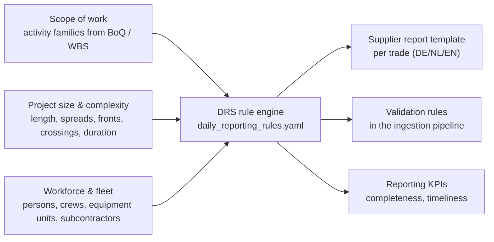

# Daily Reporting Standard (DRS): Construction-Implementation Engineering Framework

Owners: the user (domain lead) with field-operations-specialist, commercial-analyst and data-engineer. Version 0.1, 2026-11-23. Status: **draft for joint development**.
User direction (2026-11-23):
- There are no project rules for daily reports today.
- They are to be **engineered together**, based on each project's **scope of work, size and workforce**.
- Supervisor/countersignature controls are **out of scope for now** (D-090).

## 1. Purpose
Daily reports today record presence, not output or location. In 10 real supplier reports, none gave a KP, most gave no quantity, and equipment hours were almost never measured (see `03_as_is_analysis/supplier_daily_reports_analysis*.md`). The DRS defines, **per project**, what every daily report must contain so that it can be reconciled automatically. It is generated from project parameters rather than written by hand each time.

## 2. Method: from project parameters to reporting rules

### 2.1 Activity families (from the scope of work)
Each BoQ item belongs to one family, and the family fixes the **measurement rule** and the **evidence**.

| Family | Examples (from the 11 reports) | Unit & rule of credit [proposed] | Location key | Independent evidence |
|---|---|---|---|---|
| Linear mainline | ROW prep, trench, lowering, backfill, reinstatement | m per activity, daily, from–to | Plan sheet + KP from/to | Drone / as-built survey |
| Count-based | Welds, field joints, NDT shots | nr with IDs (weld / joint no.) | Weld no. → KP | Weld log / NDT register |
| Crossing objects | Auger bore, ramming, direct piping, HDD | Stage % per object (pits, casing, product pipe; pilot / ream / pull-back) | Crossing ID | Drone pit survey, HDD datalogger |
| Testing | Hydrotest, duct pressure test, pigging | m **per component that passed** | Test section / sheet range | Test protocol per component |
| Lump-sum / station | Valve stations, pipe yards | Stage % with stage weights | Station ID + stage | Inspection record, drone, photos |
| Logistics | Pipe transport, stringing supply | Pieces / m with pipe numbers | From → to sheet | Pipe tally |
| Time-based | Daywork, standby, technician day rates | Hours / days with reason + instruction | Front / crossing | Presence sensing, telematics |

### 2.2 Reporting tier (from size and workforce)
The proposed thresholds are **for the user to set**.

| Tier | Trigger (any) | Report unit | Frequency | Location | Resources |
|---|---|---|---|---|---|
| **S** small/specialist | ≤ 5 persons, single location, ≤ 2 weeks | Per supplier per day | Daily (weekly accepted with daily rows) | Crossing / station / sheet | Persons × net hours; equipment list |
| **M** standard | 6–25 persons, or several locations | **Per crew per day** | Daily, next working day | Plan sheet + KP from/to per line | Man-hours by role, hours basis; equipment hours with basis |
| **L** major front | > 25 persons, or mainline spread, or > 1 km/day | Per crew per front per day | Daily, same day | KP from/to per line (mandatory) | As M + equipment telematics where available |

### 2.3 Field rules (all tiers, unless noted)
| ID | Rule [proposed default] | Why (evidence) |
|---|---|---|
| DRS-01 | One record per **work date**. Weekly or cumulative sheets must carry daily rows | RPT-G, RPT-I |
| DRS-02 | Every quantity line has an **activity code from the project catalogue**, a **unit** and a **location key** of the required type | No KP in 10/10 |
| DRS-03 | Days without output use an explicit **non-production class** (mobilisation, set-up, standby, logistics). No blank quantity | ~6/10 presence-only |
| DRS-04 | **Rework / repeat** is reported separately from progress, with a cause | RPT-H, RPT-N |
| DRS-05 | Test-type quantities are reported **per component with pass/fail** | RPT-N |
| DRS-06 | Labour: persons × hours with **hours basis** (gross/net). Breaks deducted | RPT-F |
| DRS-07 | Equipment: unit ID + hours with **basis** (meter, logger, declared) | 9/10 estimated |
| DRS-08 | Downtime/standby: **reason code + start/end** (who instructed it: optional for now) | RPT-I |
| DRS-09 | Machine-readable delivery (Excel template or app). Scans only by exception | 2/10 image-only |
| DRS-10 | Totals must be arithmetically consistent; no template residue | RPT-C, RPT-F, RPT-G |
| DRS-11 | Photos: tier L/M at least 1 per front per day, geotagged (optional for S) | 0/10 with photos |

## 3. How the rules are used
1. Project set-up: fill `04_to_be_architecture/data_model/daily_reporting_rules.yaml` from the scope of work, size and workforce.
2. The platform generates the **supplier template** for each trade and the **validation rules** for ingestion.
3. Rule failures feed the review queue (not payment blocks), and the reporting-quality KPI per supplier on the scorecard.

## 4. Decisions to make together (workshop agenda)
1. The activity-family catalogue for this project (from the BoQ / WBS).
2. Tier thresholds (persons, locations, metres/day).
3. Location-key standard: is the plan sheet always mandatory, and is KP mandatory for tier L?
4. Downtime and non-production code list.
5. Photo/evidence minimum per tier.
6. Delivery deadline and format (Excel template vs app).
7. Which rules become contract requirements in future subcontracts (later, with Legal).
