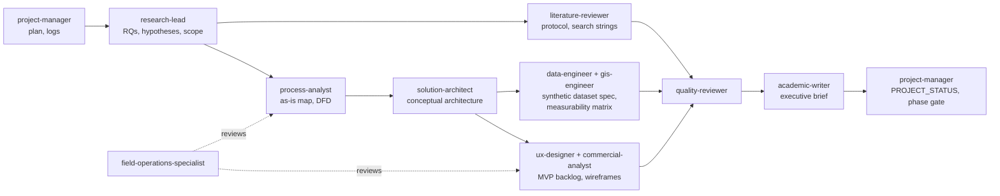

# Agent Roster and Execution Rules

The project runs as 14 specialist agents. An agent can be a human team member, a Claude Code subagent, or the student working in that role. Each brief defines a contract: what the agent receives, what it must produce, where the output goes, and when it must escalate.

## Roster and output folders

| # | Agent | Brief | Primary output folder | Main phases |
|---|---|---|---|---|
| 1 | project-manager | [project-manager.md](project-manager.md) | `00_project_management/`, root logs | all |
| 2 | research-lead | [research-lead.md](research-lead.md) | `05_methodology/` | 0, 1, 5, 7 |
| 3 | literature-reviewer | [literature-reviewer.md](literature-reviewer.md) | `02_literature_review/` | 0, 2 |
| 4 | process-analyst | [process-analyst.md](process-analyst.md) | `03_as_is_analysis/` | 0, 3, 4 |
| 5 | solution-architect | [solution-architect.md](solution-architect.md) | `04_to_be_architecture/` | 0, 4 |
| 6 | data-engineer | [data-engineer.md](data-engineer.md) | `04_to_be_architecture/data_model/`, `data/` | 0, 4, 6 |
| 7 | gis-engineer | [gis-engineer.md](gis-engineer.md) | `04_to_be_architecture/geospatial/` | 0, 4, 6 |
| 8 | ux-designer | [ux-designer.md](ux-designer.md) | `04_to_be_architecture/ux/` | 0, 4, 6 |
| 9 | full-stack-developer | [full-stack-developer.md](full-stack-developer.md) | `prototype/` | 6 (only after the MVP scope is confirmed) |
| 10 | data-scientist | [data-scientist.md](data-scientist.md) | `04_to_be_architecture/analytics/` | 4, 6, 7 |
| 11 | commercial-analyst | [commercial-analyst.md](commercial-analyst.md) | `07_business_case/` | 0, 3, 7, 8 |
| 12 | field-operations-specialist | [field-operations-specialist.md](field-operations-specialist.md) | `06_pilot_testing/` | 1, 3, 6, 7 |
| 13 | academic-writer | [academic-writer.md](academic-writer.md) | `08_thesis/`, `09_paper/`, `docs/` | 0, 8, 9 |
| 14 | quality-reviewer | [quality-reviewer.md](quality-reviewer.md) | `qa/` | end of every phase |

## Execution rules

1. **Dependencies first.** An agent starts only when its inputs exist. Dependencies are listed in `00_project_management/master_plan.csv`.
2. **Parallel where independent.** Agents that share no unfinished inputs run in parallel. Example: literature-reviewer and process-analyst run in parallel in Phase 0.
3. **One folder per agent.** Each agent writes only to its output folder, plus append-only entries in the root logs.
4. **Handover note.** On finishing a task, an agent writes `handovers/<phase>_<agent>.md` using [handover_template.md](handover_template.md).
5. **Shared logs.** Agents never keep private decision, assumption or risk lists. Every item goes into the root files: `DECISIONS_LOG.md`, `ASSUMPTIONS_LOG.md`, `RISK_REGISTER.md`, `OPEN_QUESTIONS.md`.
6. **Status.** The project-manager updates `PROJECT_STATUS.md` at the end of every phase.
7. **Code gate.** No platform code is written until the user confirms the MVP scope (decision D-005).
8. **Data.** Demonstrations use synthetic data only. Every synthetic file carries `SYNTHETIC` in its name and a header comment.
9. **Confidentiality.** Nothing confidential is published or shared outside the repository: no company names, coordinates, personnel identities, contract values or client documents. Use placeholders.
10. **Phase gate.** A phase closes only after the quality-reviewer signs off its checklist in `qa/`.

## Phase 0 dependency graph

